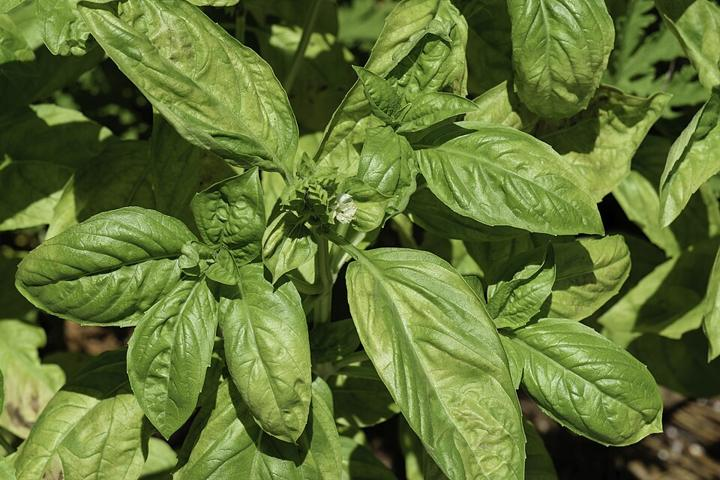

# Basil

*Photo: PumpkinSky, [CC BY-SA 4.0](https://creativecommons.org/licenses/by-sa/4.0), via [Wikimedia Commons](https://commons.wikimedia.org/wiki/File:Ocimum_basilicum_CG_NBG_LR.jpg). Resized.*

> **Darwin and Katherine.** Shaded all year on the NT sheet, so it is one of the few things you can start in the wet. Figures come from the NT Government sowing sheet ([NT DAF IS4](https://daf.nt.gov.au/__data/assets/pdf_file/0003/228090/is4_vegetable_calendar_darwin_katherine_08.pdf)), which is government but old (2005/2008). Other sources are named below.

## Key facts

| Fact | Value |
|---|---|
| When | All year |
| How | Sow seed |
| Depth | 5 mm |
| Plants apart | 30 cm |
| Rows apart | 30 cm |
| Seedlings up | 4 days |
| First pick | Not given |

The sheet gives no weeks to picking for basil.

## What you need

- Seed
- A sunny spot, or a pot

## Growing methods

- **In a pot:** Herbs can grow in pots ([NSW Environment, small spaces](https://www.environment.nsw.gov.au/about-us/get-involved/sydney-nature/gardens/small-spaces)). Salisbury says herbs generally prefer shade in summer ([Salisbury Council, growing in pots and containers](https://www.salisbury.sa.gov.au/assets/files/assets/public/general_documents/live/healthy_living/living_well_in_the_living_city/pack_e1_growing_in_pots_and_containers_final.pdf)). Neither gives a basil-specific pot size.
- More on pots, soil and water: [small spaces, pots and renting](../start/small-spaces.md).

## How to grow it

1. Sow seed 5 mm deep.
2. Seedlings come up in about 4 days.
3. Space plants 30 cm apart, in rows 30 cm apart.
4. Mulch straight after planting.

## Care guide

- **Starting:** No source read says how to raise basil seedlings. The Darwin sources only give months. A fusarium-tolerant variety (Nufar F1) is used in the Darwin Rural area ([NT Vegetable growing manual](https://industry.nt.gov.au/__data/assets/pdf_file/0019/228007/ntg-vegetable-growing-manual.pdf), p. 28).
- **Temperature:** Basil dislikes cold and dies back when it arrives. Frost-free tropical areas can grow it for years ([SGA](https://sgaonline.org.au/basil)).
- **Sun and shade:** Full sun. In very warm areas it tolerates part shade ([SGA](https://sgaonline.org.au/basil)).
- **Watering:** No set amount. Use the finger test: if soil sticks to your finger, skip watering. Water in the morning so leaves are not wet as the temperature drops, and do not use greywater ([SGA](https://sgaonline.org.au/basil)).
- **Feeding:** Liquid seaweed, worm wee or liquid manure, fairly often through the growing season and after harvests. The source gives no interval ([SGA](https://sgaonline.org.au/basil)).
- **Care:** Pick often to stop it getting leggy and going to seed. Remove the flowers to keep the leaves lush for longer ([SGA](https://sgaonline.org.au/basil)).
- **Common problems and fixes:** Snails and caterpillars are the pests SGA names. Regular picking, flower removal and feeding are its only fixes. Fusarium wilt is covered on the [disease page](../pests/diseases.md#fusarium-wilt-of-basil).
- **Not found:** A seedling method, feeding interval and rates.

## Pests and diseases

- **Fusarium wilt of basil** is a major Top End disease. Use resistant varieties and clean seed, and do not reuse infected soil or pots ([details](../pests/diseases.md#fusarium-wilt-of-basil), [NT guide](https://dpir.nt.gov.au/__data/assets/pdf_file/0009/227772/vegfieldguide-sml.pdf), p. 164).
- **Spiralling whitefly:** check weekly. Numbers are usually higher in the dry season, and a parasitic wasp keeps them down in most NT areas ([details](../pests/insects.md#season-notes-for-the-top-end), [NT guide](https://dpir.nt.gov.au/__data/assets/pdf_file/0009/227772/vegfieldguide-sml.pdf), p. 88).
- The sheet gives no pest advice for basil.
- Organic fixes are on the [insect pests page](../pests/insects.md) and the [diseases page](../pests/diseases.md).

## See it and watch it

[Photos: search Wikimedia Commons](https://commons.wikimedia.org/w/index.php?search=basil+Ocimum+basilicum&title=Special%3AMediaSearch&type=image) · [Videos: search YouTube](https://www.youtube.com/results?search_query=how+to+grow+basil+in+a+pot+Australia)

The links open search results for this crop. I have not vetted every result against this guide, so use the photos to identify the plant and check any video advice against the sources above.

## More

[Full Northern Territory guide](../states/nt.md) · [Small spaces and pots](../start/small-spaces.md)

## Sources

- [NT DAF IS4](https://daf.nt.gov.au/__data/assets/pdf_file/0003/228090/is4_vegetable_calendar_darwin_katherine_08.pdf), government
- [NT DPIF field guide to vegetable pests and diseases (2014)](https://dpir.nt.gov.au/__data/assets/pdf_file/0009/227772/vegfieldguide-sml.pdf), government
- [SGA, basil](https://sgaonline.org.au/basil), community
- [NT Vegetable growing manual](https://industry.nt.gov.au/__data/assets/pdf_file/0019/228007/ntg-vegetable-growing-manual.pdf), government
