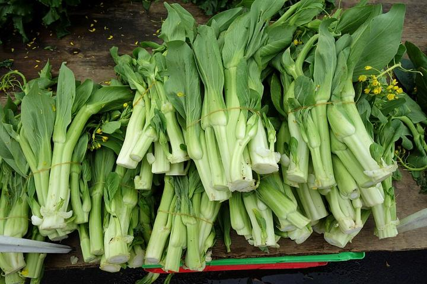

# Bok choy and Asian greens

*Photo: Daderot, [CC0](http://creativecommons.org/publicdomain/zero/1.0/deed.en), via [Wikimedia Commons](https://commons.wikimedia.org/wiki/File:Bok_choy_-_Harbourside_Market,_Wellington,_New_Zealand_-_DSC09779.jpg). Resized.*

> **Darwin and Katherine.** A fast Asian green. The sheet gives the same timing for bok choy, tatsoi and Chinese broccoli. Figures come from the NT Government sowing sheet[113](../references.md#r113), which is government but old (2005/2008). Other sources are named below.

## Key facts

| Fact | Value |
|---|---|
| When | Apr to Aug |
| How | Sow seed |
| Depth | 5 mm |
| Plants apart | 20 cm |
| Rows apart | 30 cm |
| Seedlings up | 5 to 7 days |
| First pick | 4 to 6 weeks |

## Soil and rotation

| | |
|---|---|
| Family | Cabbage family (brassica) |
| Feeder level | Heavy (SGA[267](../references.md#r267), Salisbury Council[188](../references.md#r188)) |
| What it takes | A lot. Heavy feeders draw hard on the bed (SGA[267](../references.md#r267)). |
| What it gives back | No nitrogen added. Roots and leftover leaves return some organic matter, and compost puts nutrients back [general knowledge]. |
| Plant before it | A wet-season green manure. The NT manual puts a green manure in every wet season (NT manual[139](../references.md#r139)). |
| Plant after it | Snake beans. The NT manual puts beans after a leafy crop. Keep cabbage-family crops out of clubroot beds. |
| Watch out for | Clubroot spores last up to 20 years. Salisbury says other families for one to two seasons, while the industry sheet says over 7 years, so keep cabbage-family crops out of infected beds. |

The pattern for every crop in this guide is in [what to plant after each crop](../principles.md#what-to-plant-after-each-crop).

## What you need

- Seed
- A raised bed or a deep pot
- Mulch

## Growing methods

- **In a pot:** Asian greens can grow in pots[99](../references.md#r99). Bok choy prefers shade, especially in summer[186](../references.md#r186).
- **In a bed:** Raised beds 10 to 15 cm high drain better. This is general advice on the Darwin and Katherine sowing sheet[113](../references.md#r113).
- More on pots, soil and water: [small spaces, pots and renting](../start/small-spaces.md).

## How to grow it

1. Sow seed 5 mm deep, rows 30 cm apart, plants 20 cm apart.
2. Seedlings come up in 5 to 7 days.
3. Pick from about 4 to 6 weeks.

## Care guide

- **Starting:** Sow a few seeds at a time so harvests spread over months, about 20 cm apart[263](../references.md#r263). Sow in the bed or in trays of seed-raising mix and transplant when 5 to 7 cm tall[284](../references.md#r284).
- **Temperature:** Does best in mild weather, and summer heat causes bolting, which makes leaves bitter and tough. No temperature figures are given[284](../references.md#r284).
- **Sun and shade:** Full sun. In very hot summers part shade is fine, for example beans or sweet corn as living shade or a shade tent[263](../references.md#r263). Use shade cloth in hot weather to reduce bolting[284](../references.md#r284).
- **Watering:** Roots are shallow, so water often in hot or windy weather. Mulch the bed and check soil moisture regularly[263](../references.md#r263). Pea straw or lucerne works as mulch[284](../references.md#r284).
- **Feeding:** Before planting, mix one part compost to three parts soil or add well-rotted manure. Use seaweed solution at planting and half-strength manure or compost tea every fortnight[263](../references.md#r263). Bunnings also says liquid fertiliser every two weeks.
- **Care:** Pick outer leaves from about 6 weeks, or cut the whole plant at about 8 weeks[263](../references.md#r263). Remove large stones from the bed so the plants are not misshapen.
- **Common problems and fixes:** Snails are the biggest pest: SGA suggests coffee grounds around the bed. Bunnings lists traps, organic pellets or copper tape. Caterpillars: pick them off or use a bio-insecticide and follow the label. Bolting: shade cloth[284](../references.md#r284). Diamondback moth is on the [insect page](../pests/insects.md#diamondback-moth).
- **Not found:** Temperature figures and a watering frequency.

## Companion crops

- **Good neighbours:** [Beans](darwin-snake-beans.md), [Beetroot](../companions.md#beetroot), [Cabbage family](../companions.md#cabbage-family), [Carrot](../companions.md#carrot), [Cucumber](darwin-cucumber.md), [Marjoram](../companions.md#marjoram), [Peas](../companions.md#peas), [Strawberries](../companions.md#strawberries), [Dill](../companions.md#dill), [Celery](../companions.md#celery), [Tomato](darwin-cherry-tomato.md).
- **Keep apart:** [Parsley](../companions.md#parsley).
- **How reliable:** Weak. Most of these pairings are traditional practice, and the trials read found little support for them. Sources: SGA[263](../references.md#r263) lists the first group and says avoid parsley. NT sheet VF11[125](../references.md#r125) adds dill, celery, tomato and aromatic herbs for cabbage-family crops. Each pairing is rated on the [companion crops page](../companions.md).
- Flowering strips of alyssum, cornflower or buckwheat are the best-supported companion practice; see [Alyssum, cornflower and buckwheat strips](../companions.md#alyssum-cornflower-and-buckwheat-strips).

## Pests and diseases

- **Diamondback moth** chews windows and holes in leaves. It is favoured by warm dry weather, and wet-season rain reduces it ([details](../pests/insects.md#diamondback-moth), NT guide[120, p. 62](../references.md#r120)).
- **Cluster caterpillar** skeletonises leaves ([details](../pests/insects.md#helicoverpa-and-cluster-caterpillars), NT guide[120, p. 56](../references.md#r120)).
- **Black rot and leaf spots:** use clean seed, remove residue and avoid overhead watering ([details](../pests/diseases.md#leaf-spots-alternaria-cercospora-and-bacterial), NT guide[120, p. 132 to 140](../references.md#r120)).
- Organic fixes are on the [insect pests page](../pests/insects.md) and the [diseases page](../pests/diseases.md).

## See it and watch it

[Photos: search Wikimedia Commons](https://commons.wikimedia.org/w/index.php?search=bok+choy+Brassica+rapa+chinensis&title=Special%3AMediaSearch&type=image) · [Videos: search YouTube](https://www.youtube.com/results?search_query=how+to+grow+bok+choy+Australia)

The links open search results for this crop. I have not vetted every result against this guide, so use the photos to identify the plant and check any video advice against the sources above.

## More

[Full Northern Territory guide](../states/nt.md) · [Small spaces and pots](../start/small-spaces.md)

## Sources

Numbers in square brackets on this page are references. Open one for the full source, who published it and what kind of source it is.

[99](../references.md#r99) [113](../references.md#r113) [120](../references.md#r120) [125](../references.md#r125) [139](../references.md#r139) [186](../references.md#r186) [188](../references.md#r188) [263](../references.md#r263) [267](../references.md#r267) [284](../references.md#r284)

All references are in the [References appendix](../references.md).
