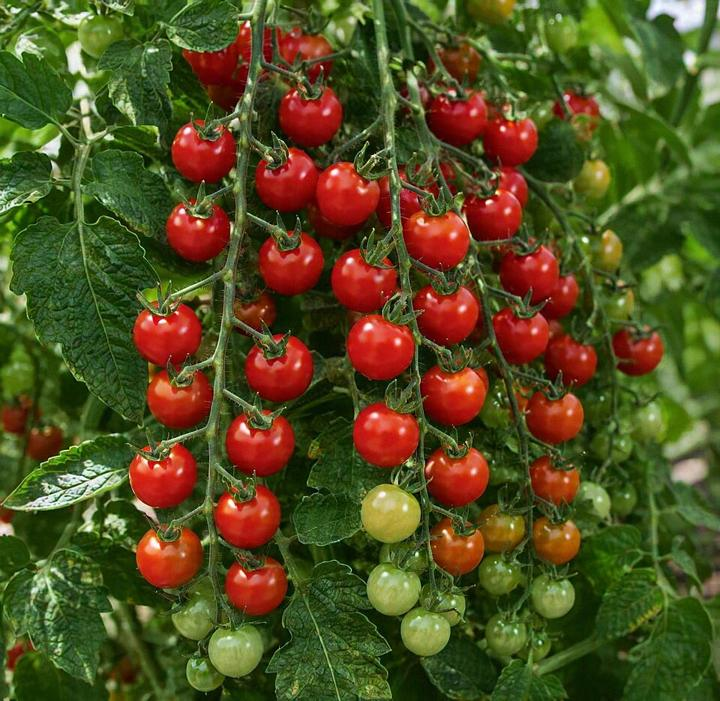

# Cherry tomato

*Photo: Steffen Bauer (saatpilot.de), [CC BY 4.0](https://creativecommons.org/licenses/by/4.0), via [Wikimedia Commons](https://commons.wikimedia.org/wiki/File:Solanum_lycopersicum_%27Small_Red_Cherry%27_(tomato),_fruit,_close-up_(SaatPilot).jpg). Resized.*

> **Darwin and Katherine.** A dry-season crop. The NT Government says to raise seedlings in a protected nursery, not to direct-seed. Figures come from the NT Government sowing sheet[113](../references.md#r113), which is government but old (2005/2008). Other sources are named below.

## Key facts

| Fact | Value |
|---|---|
| When | Apr to Jul |
| How | Sow seed |
| Depth | 10 mm |
| Plants apart | 30 cm |
| Rows apart | 300 cm |
| Seedlings up | 7 to 10 days |
| First pick | 7 to 8 weeks |

Timing: the sheet shades April to July for cherry tomato and May to July for full-size tomato. The NT tomato page says late April to July.

## Soil and rotation

| | |
|---|---|
| Family | Tomato family (nightshade) |
| Feeder level | Heavy (SGA[267](../references.md#r267), Salisbury Council[188](../references.md#r188)) |
| What it takes | A lot. Heavy feeders draw hard on the bed (SGA[267](../references.md#r267)). |
| What it gives back | No nitrogen added. Roots and leftover leaves return some organic matter, and compost puts nutrients back [general knowledge]. |
| Plant before it | A legume or a green manure (SGA[267](../references.md#r267)), applied to the Top End [inference]. |
| Plant after it | A grass green manure (sorghum or pearl millet) in the wet season, then vegetables from another family [inference]. Legume covers host root-knot nematodes. |
| Watch out for | Salisbury Council says a three-year break before the family returns, and root-knot nematodes build under tomato. |

The pattern for every crop in this guide is in [what to plant after each crop](../principles.md#what-to-plant-after-each-crop).

## What you need

- Seed or seedlings
- Small pots to raise seedlings
- A raised bed with good drainage
- Stakes or a cage `[inference]`

## Growing methods

- **In a pot:** Cherry tomatoes suit a medium pot, 20 to 30 cm deep[186](../references.md#r186). Tomatoes can also grow in hanging baskets[99](../references.md#r99).
- **In a bed:** Raised beds 10 to 15 cm high drain better. This is general advice on the Darwin and Katherine sowing sheet[113](../references.md#r113).
- More on pots, soil and water: [small spaces, pots and renting](../start/small-spaces.md).

## How to grow it

1. Raise seedlings in a protected spot, sowing seed 10 mm deep. Seedlings come up in 7 to 10 days.
2. Plant out in the late afternoon or on a cool, cloudy day, 30 cm apart.
3. Water the seedlings in with a weak fertiliser solution.
4. Mulch. First picking is about 7 to 8 weeks later.

## Care guide

- **Starting:** Grow from seed or seedlings. The NT page gives late April to July as the best planting window, and says to plant seedlings into moist soil in the evening to avoid sunburn[148](../references.md#r148). The NT manual advises raising the small seed in a protected nursery rather than direct sowing[139, p. 17](../references.md#r139). An Adelaide council advises seed-raising mix, soil at 25 °C, transplanting at 3 to 5 cm with a second pair of leaves, and hardening off over several days[187](../references.md#r187).
- **Temperature:** The NT page gives no growing temperatures. The Adelaide council plants out when soil is 15 to 20 °C and uses shade cloth in extreme heat. That is a different climate from Darwin.
- **Sun and shade:** The NT page says to grow outdoors in winter and in shadehouses in summer. The council says at least 6 hours of sun, preferably morning, with shelter from the late afternoon sun and 50 percent shade cloth in extreme heat.
- **Watering:** Keep the soil moist but not wet[148](../references.md#r148). The council says a slow, deep soak, every 2 to 3 days in extreme heat, a finger test first, and water the soil rather than the leaves. In pots, water until it drains and do not use saucers.
- **Feeding:** The council says feed at least 2 to 3 times over the plant life, liquid feed about every 3 weeks, and use a potash-heavy fertiliser rather than a high-nitrogen one, which reduces fruit set. Pots need feeding more often. The NT page gives no feeding advice.
- **Care:** Tall types need a trellis about 1.8 m high or stakes[148](../references.md#r148). The council says use soft ties, pinch the side shoots on tall types and keep leaves off the soil.
- **Common problems and fixes:** Blossom end rot: water evenly. Fruit splitting: pick early if heavy rain is forecast. Sunburn: shade cloth. Bacterial wilt has no cure: remove the plants[187](../references.md#r187). Whitefly, mites, fruit fly and caterpillars are on the [insect page](../pests/insects.md), and tomato leaf curl virus on the [disease page](../pests/diseases.md#tomato-leaf-curl-virus).
- **Not found:** Tropical (Darwin) temperature and feeding figures.

## Companion crops

- **Good neighbours:** [Basil](darwin-basil.md), [Parsley](../companions.md#parsley), [Chives](../companions.md#chives), [Onions and garlic](../companions.md#onions-and-garlic), [Cucumber](darwin-cucumber.md), [Marigold](../companions.md#marigold), [Nasturtium](../companions.md#nasturtium), [Petunias](../companions.md#petunias), [Asparagus](../companions.md#asparagus).
- **Keep apart:** [Potatoes](../companions.md#potatoes), [Eggplant](../companions.md#eggplant), [Corn](../companions.md#corn).
- **How reliable:** Weak. Most of these pairings are traditional practice, and the trials read found little support for them. Sources: NT sheet VF11[125](../references.md#r125) and the Hornsby fact sheet[182](../references.md#r182). The two sources disagree on corn: the NT sheet says avoid it and Hornsby lists it as a companion. Each pairing is rated on the [companion crops page](../companions.md).
- Flowering strips of alyssum, cornflower or buckwheat are the best-supported companion practice; see [Alyssum, cornflower and buckwheat strips](../companions.md#alyssum-cornflower-and-buckwheat-strips).

## Pests and diseases

- **Tomato leaf curl virus** is one of the most serious Top End tomato diseases, spread by whitefly. Late March sowing reduced it in the guide ([details](../pests/diseases.md#tomato-leaf-curl-virus), NT guide[120, p. 188 to 193](../references.md#r120)).
- **Bacterial wilt** occurs in red soils around Darwin. Use clean potting mix ([details](../pests/diseases.md#sclerotium-base-rot-and-bacterial-wilt), NT guide[120, p. 134](../references.md#r120)).
- **Fruit fly** stings young green tomatoes ([details](../pests/insects.md#season-notes-for-the-top-end), NT guide[120, p. 70](../references.md#r120)). **Corn earworm** attacks flowers and fruit ([details](../pests/insects.md#helicoverpa-and-cluster-caterpillars), NT DPIF field guide[120, p. 58](../references.md#r120)). **Russet mite** bronzes stems from the base up ([details](../pests/insects.md#broad-rust-and-russet-mites), NT DPIF field guide[120, p. 78](../references.md#r120)).
- **Leaf spots and blossom end rot:** remove infected lower leaves, keep foliage dry and water evenly ([details](../pests/diseases.md#leaf-spots-alternaria-cercospora-and-bacterial), NT guide[120, p. 142, 196](../references.md#r120)).
- Organic fixes are on the [insect pests page](../pests/insects.md) and the [diseases page](../pests/diseases.md).

## See it and watch it

[Photos: search Wikimedia Commons](https://commons.wikimedia.org/w/index.php?search=cherry+tomato+Solanum+lycopersicum&title=Special%3AMediaSearch&type=image) · [Videos: search YouTube](https://www.youtube.com/results?search_query=how+to+grow+cherry+tomatoes+in+pots+Australia)

The links open search results for this crop. I have not vetted every result against this guide, so use the photos to identify the plant and check any video advice against the sources above.

## More

[Full Northern Territory guide](../states/nt.md) · [Small spaces and pots](../start/small-spaces.md)

## Sources

Numbers in square brackets on this page are references. Open one for the full source, who published it and what kind of source it is.

[99](../references.md#r99) [113](../references.md#r113) [120](../references.md#r120) [125](../references.md#r125) [139](../references.md#r139) [148](../references.md#r148) [182](../references.md#r182) [186](../references.md#r186) [187](../references.md#r187) [188](../references.md#r188) [267](../references.md#r267)

All references are in the [References appendix](../references.md).
