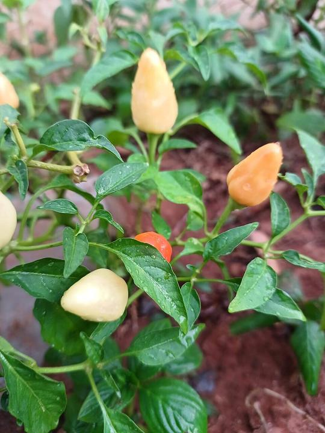

# Chilli

*Photo: Challiyan, [CC BY-SA 4.0](https://creativecommons.org/licenses/by-sa/4.0), via [Wikimedia Commons](https://commons.wikimedia.org/wiki/File:Chilli_plant_2.jpg). Resized.*

> **Darwin and Katherine.** The sheet shades April to July, and the NT chilli page says chillies can be grown all year around Darwin. Figures come from the NT Government sowing sheet ([NT DAF IS4](https://daf.nt.gov.au/__data/assets/pdf_file/0003/228090/is4_vegetable_calendar_darwin_katherine_08.pdf)), which is government but old (2005/2008). Other sources are named below.

## Key facts

| Fact | Value |
|---|---|
| When | Apr to Jul |
| How | Sow seed |
| Depth | 10 mm |
| Plants apart | 30 cm |
| Rows apart | 300 cm |
| Seedlings up | 7 to 10 days |
| First pick | 10 weeks |

## What you need

- Seedlings
- A mounded, well-drained bed
- Wind protection
- Mulch

## Growing methods

- **In a pot:** Chillies suit a medium pot, 20 to 30 cm deep ([Salisbury Council, growing in pots and containers](https://www.salisbury.sa.gov.au/assets/files/assets/public/general_documents/live/healthy_living/living_well_in_the_living_city/pack_e1_growing_in_pots_and_containers_final.pdf)).
- More on pots, soil and water: [small spaces, pots and renting](../start/small-spaces.md).

## How to grow it

1. Raise seedlings and plant them into mounded beds, 20 cm apart in single rows or 40 cm apart in double rows.
2. Use deep, well-drained, medium-textured soil. Chillies do not tolerate salt.
3. Water well and protect from wind.
4. First picking is about 10 weeks after sowing.

## Companion crops

- No source read names companion plants for chilli. See the [companion crops page](../companions.md) for what is known, and for flowering strips that suit any crop ([Alyssum, cornflower and buckwheat strips](../companions.md#alyssum-cornflower-and-buckwheat-strips)).

## Care guide

- **Starting:** Chilli is grown as seedlings and planted into mounded beds ([nt.gov.au](https://nt.gov.au/environment/home-gardens/growing-vegetables-at-home/capsicum-and-chilli)). Sow seed 5 mm deep in trays of seed-raising mix. Seeds come up in 7 to 21 days at soil temperatures of 22 to 35 °C. Transplant at 5 to 10 cm with the first true leaves ([Seed Collection](https://www.theseedcollection.com.au/growguide/chilli-seeds)).
- **Temperature:** Suited to 15 to 32 °C. Plants do not grow below 10 °C, and above 32 °C pollination can suffer ([nt.gov.au](https://nt.gov.au/environment/home-gardens/growing-vegetables-at-home/capsicum-and-chilli)).
- **Sun and shade:** Full sun, at least 6 hours a day ([Seed Collection](https://www.theseedcollection.com.au/growguide/chilli-seeds)). Protect plants from wind ([nt.gov.au](https://nt.gov.au/environment/home-gardens/growing-vegetables-at-home/capsicum-and-chilli)).
- **Watering:** Water well. The NT page says to use mulch with drip irrigation. Water deeply in the early morning or late afternoon when the soil is dry about 5 cm down, and keep the leaves dry ([Seed Collection](https://www.theseedcollection.com.au/growguide/chilli-seeds)).
- **Feeding:** In well-prepared soil no extra fertiliser is needed. In poor soil use a balanced fruit and vegetable fertiliser, as slow-release at transplanting or liquid while flowering and fruiting. Container plants may need more ([Seed Collection](https://www.theseedcollection.com.au/growguide/chilli-seeds)). No rates or intervals are given.
- **Care:** Stake or use a tripod. Pick regularly and cut fruit leaving about 3 cm of stem. In pots use at least a 20 L container ([Seed Collection](https://www.theseedcollection.com.au/growguide/chilli-seeds)). Plants grow to about 90 cm ([nt.gov.au](https://nt.gov.au/environment/home-gardens/growing-vegetables-at-home/capsicum-and-chilli)).
- **Common problems and fixes:** Aphids and whitefly: hose off or use a soap spray. Fruit fly: remove fallen fruit and use exclusion netting or traps. Blossom end rot: water evenly. Sunscald: do not prune in midsummer and use light fabric on very hot days. Wilts have no cure: remove the plant, rotate and choose resistant types ([Seed Collection](https://www.theseedcollection.com.au/growguide/chilli-seeds)). See the Darwin mites, anthracnose and pink disease entries below.
- **Not found:** Feeding rates, and a Darwin source for sun and shade.

## Pests and diseases

- **Broad mite and rust mite** curl and bronze leaves, and broad mite breeds in 4 to 5 days in the dry season. Check young top leaves weekly ([details](../pests/insects.md#broad-rust-and-russet-mites), [NT guide](https://dpir.nt.gov.au/__data/assets/pdf_file/0009/227772/vegfieldguide-sml.pdf), p. 72 to 76).
- **Spiralling whitefly** and **fruit fly** are the other pests to watch ([details](../pests/insects.md#season-notes-for-the-top-end), [NT guide](https://dpir.nt.gov.au/__data/assets/pdf_file/0009/227772/vegfieldguide-sml.pdf), p. 70, 88).
- **Anthracnose** causes sunken spots on ripening fruit, worse in wet, windy weather. **Pink disease** girdles stems in humid, foggy, rainy weather ([details](../pests/diseases.md#anthracnose-and-pink-disease-of-chilli), [NT guide](https://dpir.nt.gov.au/__data/assets/pdf_file/0009/227772/vegfieldguide-sml.pdf), p. 146, 172).
- **Bacterial wilt** hits chilli in Darwin's red soils ([details](../pests/diseases.md#sclerotium-base-rot-and-bacterial-wilt), [NT guide](https://dpir.nt.gov.au/__data/assets/pdf_file/0009/227772/vegfieldguide-sml.pdf), p. 134).
- The NT page lists caterpillars, fruit fly, aphids, rots, wilts and viruses. Rain and high humidity raise disease risk.
- Plants do not grow below 10 degrees Celsius, and pollination can suffer above 32 degrees.
- Organic fixes are on the [insect pests page](../pests/insects.md) and the [diseases page](../pests/diseases.md).

## See it and watch it

[Photos: search Wikimedia Commons](https://commons.wikimedia.org/w/index.php?search=chilli+Capsicum+annuum&title=Special%3AMediaSearch&type=image) · [Videos: search YouTube](https://www.youtube.com/results?search_query=how+to+grow+chillies+in+pots+Australia)

The links open search results for this crop. I have not vetted every result against this guide, so use the photos to identify the plant and check any video advice against the sources above.

## More

[Full Northern Territory guide](../states/nt.md) · [Small spaces and pots](../start/small-spaces.md)

## Sources

- [NT DAF IS4](https://daf.nt.gov.au/__data/assets/pdf_file/0003/228090/is4_vegetable_calendar_darwin_katherine_08.pdf), government
- [nt.gov.au, capsicum and chilli](https://nt.gov.au/environment/home-gardens/growing-vegetables-at-home/capsicum-and-chilli), government
- [NT DPIF field guide to vegetable pests and diseases (2014)](https://dpir.nt.gov.au/__data/assets/pdf_file/0009/227772/vegfieldguide-sml.pdf), government
- [The Seed Collection, chilli](https://www.theseedcollection.com.au/growguide/chilli-seeds), retailer
