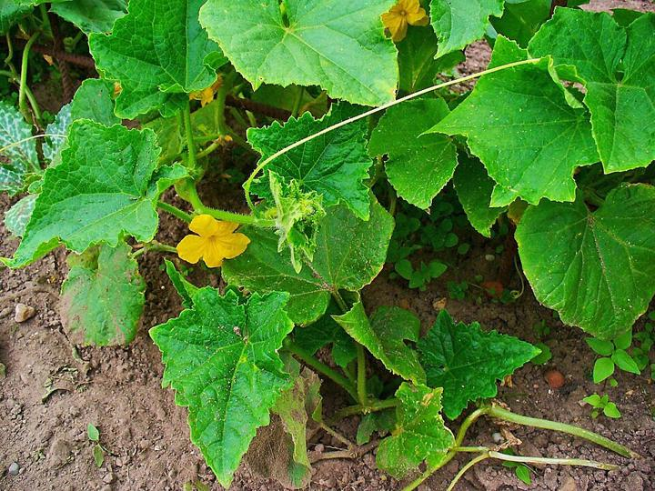

# Cucumber

*Photo: H. Zell, [CC BY-SA 3.0](https://creativecommons.org/licenses/by-sa/3.0), via [Wikimedia Commons](https://commons.wikimedia.org/wiki/File:Cucumis_sativus_0001.JPG). Resized.*

> **Darwin and Katherine.** A quick crop, picked in about 5 to 6 weeks. Figures come from the NT Government sowing sheet ([NT DAF IS4](https://daf.nt.gov.au/__data/assets/pdf_file/0003/228090/is4_vegetable_calendar_darwin_katherine_08.pdf)), which is government but old (2005/2008). Other sources are named below.

## Key facts

| Fact | Value |
|---|---|
| When | Apr to Aug |
| How | Direct sow |
| Depth | 10 to 15 mm |
| Plants apart | 40 to 60 cm |
| Rows apart | 100 to 150 cm |
| Seedlings up | 6 to 10 days |
| First pick | 5 to 6 weeks |

Timing: the sheet shades April to August. The NT Agnote B4 says cucumber can be grown throughout the year.

## What you need

- Seed
- Space or a trellis
- A raised bed

## Growing methods

- **In a pot:** Cucumber suits a deep pot, 30 to 50 cm or more ([Salisbury Council, growing in pots and containers](https://www.salisbury.sa.gov.au/assets/files/assets/public/general_documents/live/healthy_living/living_well_in_the_living_city/pack_e1_growing_in_pots_and_containers_final.pdf)). Use a trellis or reinforced mesh for climbers ([NSW Environment, small spaces](https://www.environment.nsw.gov.au/about-us/get-involved/sydney-nature/gardens/small-spaces)).
- **In a bed:** Raised beds 10 to 15 cm high drain better. This is general advice on the Darwin and Katherine sowing sheet ([NT DAF IS4](https://daf.nt.gov.au/__data/assets/pdf_file/0003/228090/is4_vegetable_calendar_darwin_katherine_08.pdf)).
- More on pots, soil and water: [small spaces, pots and renting](../start/small-spaces.md).

## How to grow it

1. Sow seed 10 to 15 mm deep, plants 40 to 60 cm apart, rows 100 to 150 cm apart.
2. Seedlings come up in 6 to 10 days.
3. Mulch after sowing.
4. Pick from about 5 to 6 weeks.

## Companion crops

- **Good neighbours:** [Beans](darwin-snake-beans.md), [Peas](../companions.md#peas), [Corn](../companions.md#corn), [Sunflower](../companions.md#sunflower), [Radish](darwin-radish.md).
- **Keep apart:** [Aromatic herbs](../companions.md#aromatic-herbs), [Potatoes](../companions.md#potatoes).
- **Where this comes from:** From [NT sheet VF11](https://daf.nt.gov.au/__data/assets/pdf_file/0005/227606/vf11.pdf) and the [Hornsby fact sheet](https://hornsby.nsw.gov.au/__data/assets/pdf_file/0015/52512/HSC00272-EGFS-Guild-and-Companion-Planting_FA.pdf).
- **How reliable:** weak. Most of these pairings are traditional practice, and the trials read found little support for them. The [companion crops page](../companions.md) rates each one. A name that has a crop page in this guide opens that page. Any other name opens its note on the companion crops page.
- Flowering strips of alyssum, cornflower or buckwheat are the best-supported companion practice; see [Alyssum, cornflower and buckwheat strips](../companions.md#alyssum-cornflower-and-buckwheat-strips).

## Care guide

- **Starting:** Sow 3 to 4 seeds 0.5 to 1 cm deep at each station, 30 to 40 cm apart if trellised (double if not) in rows 1 to 1.5 m apart, and thin to one plant at the two-leaf stage ([Agnote B4](https://daf.nt.gov.au/__data/assets/pdf_file/0005/233384/352.pdf)). The NT sheet says sow all year but pests and disease are hardest to control in the hot, humid wet season, and long green types suit the Top End better than apple types, which lack mildew resistance. Another source gives germination in 4 to 10 days in soil at 18 to 35 °C ([Seed Collection](https://www.theseedcollection.com.au/growguide/cucumber-seeds), a retailer). SGA suggests mounds about 40 cm across with two plants each ([SGA](https://sgaonline.org.au/cucumbers)).
- **Temperature:** A warm-season crop that frost damages ([Seed Collection](https://www.theseedcollection.com.au/growguide/cucumber-seeds)). No growing temperature figures are given.
- **Sun and shade:** Full sun in cool areas. In warm areas with hot summers SGA suggests 30 to 50 percent shade cover ([SGA](https://sgaonline.org.au/cucumbers)).
- **Watering:** Cucumbers need plenty of moisture. Mature plants with developing fruit need daily irrigation. Use drippers or basin irrigation and keep the leaves dry ([Agnote B4](https://daf.nt.gov.au/__data/assets/pdf_file/0005/233384/352.pdf)). SGA says drip under a 5 to 7 cm mulch, and do not let plants dry out or fruit can turn bitter ([SGA](https://sgaonline.org.au/cucumbers)).
- **Feeding:** The NT sheet gives farm rates: lime to reach about pH 6.5, compost or well-rotted manure at about a bucket per square metre in each planting station, a complete fertiliser (14:14:12) at 70 g per square metre along the rows a week before planting, then a 50:50 urea and potassium sulphate side dressing at 20 g per square metre (about 10 g per station) when runners are 30 cm long, and again after the first fruit sets ([Agnote B4](https://daf.nt.gov.au/__data/assets/pdf_file/0005/233384/352.pdf)). Those are farm rates, not tested in pots. For a gentler home approach, SGA suggests compost, then worm wee or seaweed liquid at planting and when the first small fruits appear ([SGA](https://sgaonline.org.au/cucumbers)).
- **Care:** In the wet season build raised beds or hills 15 to 20 cm high for drainage, and water at the base. Mulch between plants to suppress weeds, hold moisture, keep soil cool and give cleaner fruit. Train vines over a low trellis or fence. Pick often and remove diseased, over-ripe and oddly shaped fruit ([Agnote B4](https://daf.nt.gov.au/__data/assets/pdf_file/0005/233384/352.pdf)). Cut fruit with scissors or a knife and leave some stem ([SGA](https://sgaonline.org.au/cucumbers), [NT manual](https://industry.nt.gov.au/__data/assets/pdf_file/0019/228007/ntg-vegetable-growing-manual.pdf), p. 33). Pinch the tip after 5 to 7 leaves (SGA).
- **Rotation:** Cucumber family, heavy feeder. The NT manual's order is a leafy crop, then beans, then cucumber-family crops, with a green manure between. Root-knot nematodes build under cucumber-family crops. See [rotation for the crops in this guide](../principles.md#rotation-for-the-crops-in-this-guide).
- **Plant next, so the soil recovers:** Grow a grass green manure (sorghum or pearl millet) in the wet season, then a leafy crop in the dry season. The NT manual puts a green manure after cucumber-family crops. Avoid legume covers where nematodes are a problem. See [what to plant after each crop](../principles.md#what-to-plant-after-each-crop).
- **Common problems and fixes:** Fungal disease: clean straw mulch, drip watering, airflow and a trellis. Poor fruit set: attract bees with flowers, or move pollen from a male to a female flower with a brush. Bitter fruit: water evenly ([SGA](https://sgaonline.org.au/cucumbers)). Spider mites and aphids: see the [insect page](../pests/insects.md). Sunscald: cover with light fabric on very hot days ([Seed Collection](https://www.theseedcollection.com.au/growguide/cucumber-seeds)).
- **Not found:** Sun and shade in any NT source, and temperature ranges. The NT sheet also gives no non-chemical fixes for the main pests.

## Pests and diseases

- **Melon aphid** spreads the mosaic viruses ([details](../pests/insects.md#cowpea-and-melon-aphids), [NT guide](https://dpir.nt.gov.au/__data/assets/pdf_file/0009/227772/vegfieldguide-sml.pdf), p. 30). Pull out plants with mottled, distorted leaves ([mosaic viruses](../pests/diseases.md#cucurbit-mosaic-viruses), [NT guide](https://dpir.nt.gov.au/__data/assets/pdf_file/0009/227772/vegfieldguide-sml.pdf), pp. 188 to 193).
- **Cucumber moth and pumpkin beetle** chew leaves and tips. Bt works only on very young caterpillars ([cucumber moth](../pests/insects.md#cucumber-moth), [NT guide](https://dpir.nt.gov.au/__data/assets/pdf_file/0009/227772/vegfieldguide-sml.pdf), p. 60).
- **Melon thrips** make silvery, crinkled leaves ([details](../pests/insects.md#melon-thrips), [NT guide](https://dpir.nt.gov.au/__data/assets/pdf_file/0009/227772/vegfieldguide-sml.pdf), p. 84).
- **Alternaria blight and downy and powdery mildew** are covered on the [diseases page](../pests/diseases.md#leaf-spots-alternaria-cercospora-and-bacterial) ([NT guide](https://dpir.nt.gov.au/__data/assets/pdf_file/0009/227772/vegfieldguide-sml.pdf), p. 136 to 174). The guide says downy mildew needs wet conditions.
- **Choanephora wet rot** can rot fruit in 24 to 48 hours in warm humid rain. Keep fruit off the soil on a trellis or mulch ([details](../pests/diseases.md#choanephora-wet-rot), [NT guide](https://dpir.nt.gov.au/__data/assets/pdf_file/0009/227772/vegfieldguide-sml.pdf), p. 154).
- Organic fixes are on the [insect pests page](../pests/insects.md) and the [diseases page](../pests/diseases.md).

## See it and watch it

[Photos: search Wikimedia Commons](https://commons.wikimedia.org/w/index.php?search=cucumber+Cucumis+sativus&title=Special%3AMediaSearch&type=image) · [Videos: search YouTube](https://www.youtube.com/results?search_query=how+to+grow+cucumbers+on+a+trellis+Australia)

The links open search results for this crop. I have not vetted every result against this guide, so use the photos to identify the plant and check any video advice against the sources above.

## More

[Full Northern Territory guide](../states/nt.md) · [Small spaces and pots](../start/small-spaces.md)

## Sources

- [NT DAF IS4](https://daf.nt.gov.au/__data/assets/pdf_file/0003/228090/is4_vegetable_calendar_darwin_katherine_08.pdf), government
- [NT DPIF field guide to vegetable pests and diseases (2014)](https://dpir.nt.gov.au/__data/assets/pdf_file/0009/227772/vegfieldguide-sml.pdf), government
- [SGA, cucumbers](https://sgaonline.org.au/cucumbers), community
- [The Seed Collection, cucumber](https://www.theseedcollection.com.au/growguide/cucumber-seeds), retailer
- [NT Vegetable growing manual](https://industry.nt.gov.au/__data/assets/pdf_file/0019/228007/ntg-vegetable-growing-manual.pdf), government
- [NT Agnote B4, Growing cucumbers in the Top End (2006)](https://daf.nt.gov.au/__data/assets/pdf_file/0005/233384/352.pdf), government
