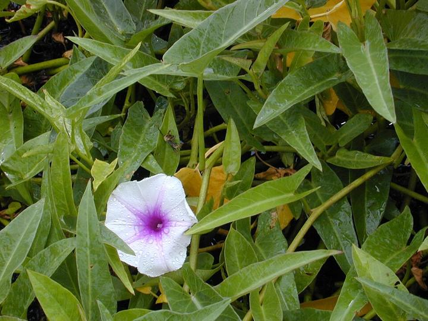

# Kang kong

*Photo: Eric Guinther, [CC BY-SA 3.0](http://creativecommons.org/licenses/by-sa/3.0/), via [Wikimedia Commons](https://commons.wikimedia.org/wiki/File:N_Ipoa_D1600.JPG). Resized.*

> **Darwin and Katherine.** A leafy vegetable sown in the dry season on the NT sheet. Figures come from the NT Government sowing sheet ([NT DAF IS4](https://daf.nt.gov.au/__data/assets/pdf_file/0003/228090/is4_vegetable_calendar_darwin_katherine_08.pdf)), which is government but old (2005/2008). Other sources are named below.

## Key facts

| Fact | Value |
|---|---|
| When | Apr to Aug |
| How | Direct sow |
| Depth | 10 mm |
| Plants apart | 10 cm |
| Rows apart | 50 cm |
| Seedlings up | 5 to 7 days |
| First pick | 7 to 8 weeks |

## What you need

- Seed
- A raised bed
- Mulch

## Growing methods

- **In a pot:** No source read for this guide gives a pot size for kang kong. This is a gap.
- **In a bed:** Raised beds 10 to 15 cm high drain better. This is general advice on the Darwin and Katherine sowing sheet ([NT DAF IS4](https://daf.nt.gov.au/__data/assets/pdf_file/0003/228090/is4_vegetable_calendar_darwin_katherine_08.pdf)).
- More on pots, soil and water: [small spaces, pots and renting](../start/small-spaces.md).

## How to grow it

1. Sow seed 10 mm deep, plants 10 cm apart, rows 50 cm apart.
2. Seedlings come up in 5 to 7 days.
3. First picking is about 7 to 8 weeks later.

## Companion crops

- No source read names companion plants for kang kong. See the [companion crops page](../companions.md) for what is known, and for flowering strips that suit any crop ([Alyssum, cornflower and buckwheat strips](../companions.md#alyssum-cornflower-and-buckwheat-strips)).

## Care guide

- **Starting:** On dry land, broadcast or sow seed in rows or raised beds, or use cuttings ([NT VF5](https://daf.nt.gov.au/__data/assets/pdf_file/0020/227603/vf5.pdf)). One Cairns grower sows seed 1 cm deep and 15 to 20 cm apart, with germination in 5 to 10 days. Cuttings with at least three nodes, one under the soil, root in 3 to 5 days ([Rob Pyne](https://robpyne.com.au/kangkong)).
- **Temperature:** Prefers steady high temperatures above 23 °C ([NT VF5](https://daf.nt.gov.au/__data/assets/pdf_file/0020/227603/vf5.pdf)). The Cairns grower says it thrives at 20 to 35 °C.
- **Sun and shade:** Full sun ([Rob Pyne](https://robpyne.com.au/kangkong)). The NT sheet does not cover sun.
- **Watering:** Keep the soil moist, but dry-land plants are not grown in flooded soil ([NT VF5](https://daf.nt.gov.au/__data/assets/pdf_file/0020/227603/vf5.pdf)). Planting at the start of the wet season cuts the need for extra watering ([Rob Pyne](https://robpyne.com.au/kangkong)).
- **Feeding:** The NT sheet says organic fertiliser and urea are applied after planting, with no amounts. The Cairns grower uses liquid fertiliser, chook manure or cow manure, also with no rates.
- **Care:** On dry land, plants are pulled 20 to 30 days after planting. For repeat cuts, cut about 10 cm above the ground before flowering and new shoots come every 2 to 3 weeks. Growing it in pots keeps it from spreading. It is a noxious weed in some areas, so check local rules ([Rob Pyne](https://robpyne.com.au/kangkong)).
- **Common problems and fixes:** Grasshoppers and caterpillars in the dry season. The Cairns grower suggests regular white oil, with no recipe given. White blister is on the [disease page](../pests/diseases.md#white-blister-of-kang-kong).
- **Not found:** Sun advice from an NT source, feeding rates, and non-chemical pest fixes.

## Pests and diseases

- **White blister:** white blisters under the leaves and pale spots on top. Keep to hygiene and avoid contaminated equipment and planting material ([details](../pests/diseases.md#white-blister-of-kang-kong), [NT guide](https://dpir.nt.gov.au/__data/assets/pdf_file/0009/227772/vegfieldguide-sml.pdf), p. 182).
- **Tortoise beetle** also feeds on kang kong, leaving round holes ([details](../pests/insects.md#sweet-potato-tortoise-beetle), [NT guide](https://dpir.nt.gov.au/__data/assets/pdf_file/0009/227772/vegfieldguide-sml.pdf), p. 38).
- The sheet gives no pest advice for kang kong.
- Organic fixes are on the [insect pests page](../pests/insects.md) and the [diseases page](../pests/diseases.md).

## See it and watch it

[Photos: search Wikimedia Commons](https://commons.wikimedia.org/w/index.php?search=kang+kong+water+spinach+Ipomoea+aquatica&title=Special%3AMediaSearch&type=image) · [Videos: search YouTube](https://www.youtube.com/results?search_query=how+to+grow+kang+kong+water+spinach+Australia)

The links open search results for this crop. I have not vetted every result against this guide, so use the photos to identify the plant and check any video advice against the sources above.

## More

[Full Northern Territory guide](../states/nt.md) · [Small spaces and pots](../start/small-spaces.md)

## Sources

- [NT DAF IS4](https://daf.nt.gov.au/__data/assets/pdf_file/0003/228090/is4_vegetable_calendar_darwin_katherine_08.pdf), government
- [NT DPIF field guide to vegetable pests and diseases (2014)](https://dpir.nt.gov.au/__data/assets/pdf_file/0009/227772/vegfieldguide-sml.pdf), government
- [NT Fact Sheet VF5, Kangkong](https://daf.nt.gov.au/__data/assets/pdf_file/0020/227603/vf5.pdf), government
- [Rob Pyne, kangkong (Cairns blog)](https://robpyne.com.au/kangkong), personal blog
