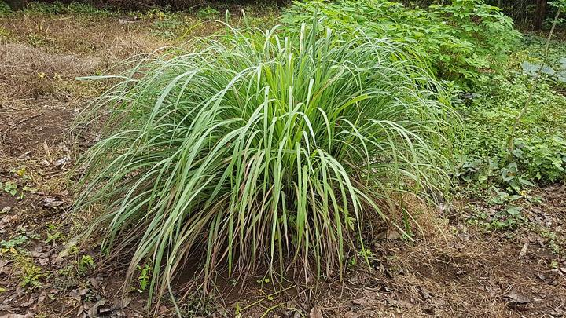

# Lemon grass

*Photo: Obsidian Soul, [CC0](http://creativecommons.org/publicdomain/zero/1.0/deed.en), via [Wikimedia Commons](https://commons.wikimedia.org/wiki/File:Tanglad_(lemongrass,_Cymbopogon_citratus)_-_Philippines.jpg). Resized.*

> **Darwin and Katherine.** Shaded all year on the NT sheet and grown from divisions, not seed. Figures come from the NT Government sowing sheet[5](../references.md#r5), which is government but old (2005/2008). Other sources are named below.

## Key facts

| Fact | Value |
|---|---|
| When | All year |
| How | Rhizome or division |
| Depth | 20 mm |
| Plants apart | 20 to 30 cm |
| Rows apart | 100 cm |
| Seedlings up | 10 days |
| First pick | 12 weeks |

## Soil and rotation

| | |
|---|---|
| Family | Grass family [general knowledge] |
| Feeder level | Not stated in the sources read. |
| What it takes | Not stated in the sources read. |
| What it gives back | No nitrogen added. Roots and leftover leaves return some organic matter, and compost puts nutrients back [general knowledge]. |
| Plant before it | No source read. |
| Plant after it | No source read. It is a perennial and stays in place [inference]. |
| Watch out for | No rotation advice found. It is a perennial clump, so it stays in place [inference]. |

The pattern for every crop in this guide is in [what to plant after each crop](../principles.md#what-to-plant-after-each-crop).

## What you need

- Divisions of lemon grass (the sheet gives the method as rhizome or division)
- A sunny spot with room for a clump

## Growing methods

- **In a pot:** No source read for this guide gives a pot size for lemon grass. This is a gap.
- More on pots, soil and water: [small spaces, pots and renting](../start/small-spaces.md).

## How to grow it

1. Plant divisions 20 mm deep, plants 20 to 30 cm apart, rows 100 cm apart.
2. Shoots appear in about 10 days.
3. Mulch after planting.
4. First picking is about 12 weeks later.

## Care guide

- **Starting:** Divide clumps in spring, making sure each piece has roots, and cut the stalks back by half before replanting. Stalk cuttings root in about 4 to 6 weeks. Seed is slow, 14 to 25 days, sown 5 mm deep and transplanted at 10 to 15 cm[33](../references.md#r33).
- **Temperature:** Suits warm dry winters and hot wet summers. In cooler areas it needs frost protection. No temperature figures are given[33](../references.md#r33).
- **Sun and shade:** Full sun is preferred, and half a day of sun is tolerated[33](../references.md#r33).
- **Watering:** Water regularly in warm, dry weather. Keep the soil moist but not waterlogged, and water at the base[33](../references.md#r33).
- **Feeding:** Mix a controlled-release all-purpose fertiliser into the top 10 to 20 cm at planting, and again in early spring after a hard cut-back. No repeat schedule is given[33](../references.md#r33).
- **Care:** Clumps reach 70 to 90 cm wide and about 90 to 100 cm tall, so use pots at least 30 to 40 cm wide and deep. Cut stalks 30 to 40 cm tall with a base at least 2 cm thick, just above the soil, and do not pull the whole clump. Use an open organic mulch[33](../references.md#r33).
- **Common problems and fixes:** Rust: improve airflow and remove affected leaves. Root rot: free-draining soil and less water[33](../references.md#r33).
- **Not found:** A government or NT source. This section rests on one retailer guide written for Australia.

## Companion crops

- No source read names companion plants for lemon grass. See the [companion crops page](../companions.md) for what is known, and for flowering strips that suit any crop ([Alyssum, cornflower and buckwheat strips](../companions.md#alyssum-cornflower-and-buckwheat-strips)).

## Pests and diseases

- The NT field guide has no lemon grass entry, and the sheet gives no pest advice for it.
- Organic fixes are on the [insect pests page](../pests/insects.md) and the [diseases page](../pests/diseases.md).

## See it and watch it

[Photos: search Wikimedia Commons](https://commons.wikimedia.org/w/index.php?search=lemon+grass+Cymbopogon+citratus&title=Special%3AMediaSearch&type=image) · [Videos: search YouTube](https://www.youtube.com/results?search_query=how+to+grow+lemongrass+Australia)

The links open search results for this crop. I have not vetted every result against this guide, so use the photos to identify the plant and check any video advice against the sources above.

## More

[Full Northern Territory guide](../states/nt.md) · [Small spaces and pots](../start/small-spaces.md)

## Sources

Numbers in square brackets on this page are references. Open one for the full source, who published it and what kind of source it is.

[5](../references.md#r5) [33](../references.md#r33)

All references are in the [References appendix](../references.md).
