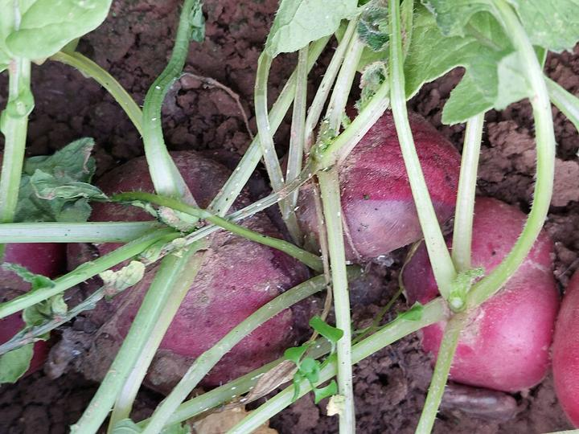

# Radish

*Photo: Schlaghecken Josef, [CC BY-SA 4.0](https://creativecommons.org/licenses/by-sa/4.0), via [Wikimedia Commons](https://commons.wikimedia.org/wiki/File:Raphanus_sativus_Radieschen,_Bakterielle_Nassf%C3%A4ule,_J.Schlaghecken-1a.jpg). Resized.*

> **Darwin and Katherine.** One of the quickest crops on the sheet. Figures come from the NT Government sowing sheet[5](../references.md#r5), which is government but old (2005/2008). Other sources are named below.

## Key facts

| Fact | Value |
|---|---|
| When | Apr to Jul |
| How | Direct sow |
| Depth | 10 to 15 mm |
| Plants apart | 3 to 5 cm |
| Rows apart | 10 to 15 cm |
| Seedlings up | 5 to 8 days |
| First pick | 6 to 8 weeks |

## Soil and rotation

| | |
|---|---|
| Family | Cabbage family (brassica) |
| Feeder level | Not stated in the sources read. |
| What it takes | Not stated in the sources read. |
| What it gives back | No nitrogen added. Roots and leftover leaves return some organic matter, and compost puts nutrients back [general knowledge]. |
| Plant before it | No source read. |
| Plant after it | A legume or a grass green manure, not a mustard cover (clubroot risk). |
| Watch out for | Clubroot spores last up to 20 years, so keep cabbage-family crops out of infected beds. A home rotation cannot clear it. |

The pattern for every crop in this guide is in [what to plant after each crop](../principles.md#what-to-plant-after-each-crop).

## What you need

- Seed
- Loose, well-drained soil

## Growing methods

- **In a pot:** No source read for this guide names radish for pots. This is a gap.
- More on pots, soil and water: [small spaces, pots and renting](../start/small-spaces.md).

## How to grow it

1. Sow seed 10 to 15 mm deep, plants 3 to 5 cm apart, rows 10 to 15 cm apart.
2. Seedlings come up in 5 to 8 days.
3. Pick from about 6 to 8 weeks.

## Care guide

- **Starting:** Sow in loose, well-drained soil with organic matter, with blood and bone dug in first. Cover the seed lightly. Seedlings come up in about a week. Thin to 10 to 15 cm, eat the thinnings, and sow every 3 to 4 weeks. Summer types take 4 to 6 weeks[29](../references.md#r29).
- **Temperature:** No figures. The page lists tropical climates as suitable and says summer types grow year-round in most climates[29](../references.md#r29).
- **Sun and shade:** Full sun[29](../references.md#r29).
- **Watering:** Keep the soil evenly moist. Dry soil causes splitting or bolting, and bolted roots turn woody and bitter[29](../references.md#r29).
- **Feeding:** Not required. Blood and bone at planting, and optionally an organic liquid fertiliser weekly or fortnightly[29](../references.md#r29).
- **Care:** Mulch with sugarcane or pea straw. Do not strip too much foliage from one plant[29](../references.md#r29).
- **Common problems and fixes:** Splitting and bolting: keep soil moist. Snails and slugs: baits or barriers. Caterpillars: Bt (DiPel) per the label. Woody roots: harvest on time[29](../references.md#r29).
- **Not found:** A Darwin or NT source, and any figure for watering or temperature. Only one retailer page was read.

## Companion crops

- **Good neighbours:** [Peas](../companions.md#peas), [Lettuce](../companions.md#lettuce), [Cucumber](darwin-cucumber.md), [Nasturtium](../companions.md#nasturtium).
- **How reliable:** Weak. Most of these pairings are traditional practice, and the trials read found little support for them. Sources: NT sheet VF11[8](../references.md#r8). Each pairing is rated on the [companion crops page](../companions.md).
- Flowering strips of alyssum, cornflower or buckwheat are the best-supported companion practice; see [Alyssum, cornflower and buckwheat strips](../companions.md#alyssum-cornflower-and-buckwheat-strips).

## Pests and diseases

- The NT field guide has no radish entry. Radish is a brassica, so the [diamondback moth](../pests/insects.md#diamondback-moth) entry may be relevant `[inference]`.
- The sheet gives no pest advice for radish.
- Organic fixes are on the [insect pests page](../pests/insects.md) and the [diseases page](../pests/diseases.md).

## See it and watch it

[Photos: search Wikimedia Commons](https://commons.wikimedia.org/w/index.php?search=radish+Raphanus+sativus&title=Special%3AMediaSearch&type=image) · [Videos: search YouTube](https://www.youtube.com/results?search_query=how+to+grow+radish+Australia)

The links open search results for this crop. I have not vetted every result against this guide, so use the photos to identify the plant and check any video advice against the sources above.

## More

[Full Northern Territory guide](../states/nt.md) · [Small spaces and pots](../start/small-spaces.md)

## Sources

Numbers in square brackets on this page are references. Open one for the full source, who published it and what kind of source it is.

[5](../references.md#r5) [6](../references.md#r6) [8](../references.md#r8) [29](../references.md#r29)

All references are in the [References appendix](../references.md).
