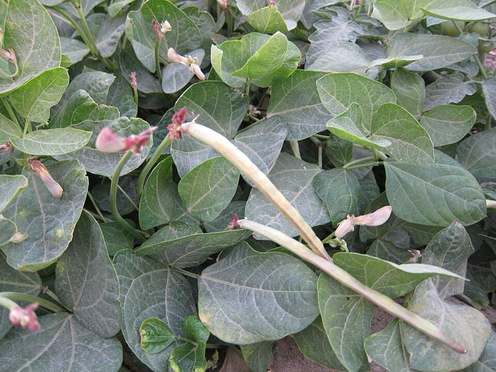

# Snake beans

*Photo: Shijan Kaakkara, [CC BY-SA 4.0](https://creativecommons.org/licenses/by-sa/4.0), via [Wikimedia Commons](https://commons.wikimedia.org/wiki/File:Yardlong_bean_-_%E0%B4%AA%E0%B4%AF%E0%B5%BC_03.jpg). Resized.*

> **Darwin and Katherine.** Can be sown all year on the NT sheet, and can grow in the wet if the bed drains well. Figures come from the NT Government sowing sheet[5](../references.md#r5), which is government but old (2005/2008). Other sources are named below.

## Key facts

| Fact | Value |
|---|---|
| When | All year |
| How | Direct sow |
| Depth | 15 to 20 mm |
| Plants apart | 10 to 15 cm |
| Rows apart | 75 cm |
| Seedlings up | 7 to 10 days |
| First pick | 8 to 10 weeks |

Row spacing: the sheet says 75 cm; the NT snake bean page says single rows about 3 m apart. Both are shown.

## Soil and rotation

| | |
|---|---|
| Family | Bean family (legume) |
| Feeder level | Soil builder (SGA[24](../references.md#r24)) |
| What it takes | Little nitrogen, because it makes its own. |
| What it gives back | Fixes nitrogen from the air, which helps about one following crop (GRDC[21](../references.md#r21)). A picked crop returns less, because 30 to 40 percent of the crop's nitrogen leaves in the harvest (SA Soil Quality[14](../references.md#r14)). Leave the roots in the bed [inference]. |
| Plant before it | A leafy crop, from the NT manual's order (NT manual[9](../references.md#r9)). |
| Plant after it | A hungry crop. The NT manual puts cucumber-family crops after beans, and the beans' nitrogen helps about one crop. Snake beans host root-knot nematodes. |
| Watch out for | Snake beans also host root-knot nematodes. |

The pattern for every crop in this guide is in [what to plant after each crop](../principles.md#what-to-plant-after-each-crop).

## What you need

- Seed (one or two per hole)
- A trellis for the vines
- A raised or mounded bed that drains well
- Organic matter to dig in before planting

## Growing methods

- **In a pot:** Peas and beans suit a medium pot, 20 to 30 cm deep. Trellised ones need a deep pot, 30 to 50 cm or more[18](../references.md#r18).
- **In a bed:** Use a raised or mounded bed that drains well, 10 to 15 cm high[5](../references.md#r5).
- More on pots, soil and water: [small spaces, pots and renting](../start/small-spaces.md).

## How to grow it

1. Add extra organic matter to the bed. If waterlogging is likely, mound the bed.
2. Sow one or two seeds per hole into slightly damp, warm soil, 15 to 20 mm deep.
3. Do not water until the seeds come up. The NT snake bean page says 3 to 5 days; the sheet says 7 to 10.
4. Train the vines onto the trellis. Keep soil moist and water in dry spells.
5. Pick about two weeks after flowering, usually 8 to 10 weeks after sowing, when the seed outlines are just visible. Pick at least twice a week, more in very hot weather.

## Care guide

- **Starting:** Sow seed directly, not as seedlings. Sow any time of year, 2 cm deep, with climbing types 30 to 50 cm apart in the row and 2 to 3 m between rows. Plant into damp soil, then do not water for 3 to 4 days, because watering straight away can rot the seed[3](../references.md#r3).
- **Temperature:** No source read gives a growing temperature. The NT page describes warm, humid conditions with steady rain and says frost damages the plants[11](../references.md#r11).
- **Sun and shade:** Not covered by any source read for snake beans.
- **Watering:** Keep soil moisture up with regular watering. Water stress lowers yield and overwatering can cause root rot. Sandy soils dry faster than heavy clay, so water them more often. Drip tape gives good control[3](../references.md#r3).
- **Feeding:** Dig in extra organic matter before planting[11](../references.md#r11). The NT farm sheet gives a complete NPK fertiliser (14:14:12) at 70 g per square metre along the rows, banded 50 mm from the seed, then a 50:50 urea and potassium sulphate side dressing at 5 g per m of row every four weeks. Those are farm rates and are not tested in pots[3](../references.md#r3).
- **Care:** Put the trellis up before planting or soon after. Mulch around the plants, keeping it clear of the stems, to suppress weeds and hold moisture. Pick at least twice a week, or the pods get too large and tough[3](../references.md#r3).
- **Common problems and fixes:** Fusarium wilt: use clean seed and good hygiene. Nematodes: grow a green manure crop each year so they do not build up[3](../references.md#r3). Bean fly, podborer, rust and wilt are covered below and on the [insect](../pests/insects.md#bean-fly) and [disease](../pests/diseases.md#fusarium-wilt-of-snake-beans) pages.
- **Not found:** Sun and shade, germination temperature and pot feeding.

## Companion crops

- **Good neighbours:** [Corn](../companions.md#corn), [Cucumber](darwin-cucumber.md), [Peas](../companions.md#peas), [Marigold](../companions.md#marigold).
- **Keep apart:** [Onions and garlic](../companions.md#onions-and-garlic).
- **How reliable:** Weak. Most of these pairings are traditional practice, and the trials read found little support for them. Sources: NT sheet VF11[8](../references.md#r8) gives advice for beans in general, not snake beans specifically. It says beans suit most vegetables and herbs. The NT farm sheet also says to grow a green manure each year against nematodes. Each pairing is rated on the [companion crops page](../companions.md).
- Flowering strips of alyssum, cornflower or buckwheat are the best-supported companion practice; see [Alyssum, cornflower and buckwheat strips](../companions.md#alyssum-cornflower-and-buckwheat-strips).

## Pests and diseases

- **Bean fly** is the worst snake bean pest in the dry season. Check seedlings twice a week in the first week after they come up ([bean fly](../pests/insects.md#bean-fly), NT guide[6, p. 66](../references.md#r6)).
- **Bean podborer and pod-sucking bug** attack flowers and pods ([details](../pests/insects.md#bean-podborer-and-pod-sucking-bug), NT guide[6, p. 50 to 54](../references.md#r6)).
- **Aphids:** cowpea aphid colonies build up before flowering ([cowpea aphid](../pests/insects.md#cowpea-and-melon-aphids), NT guide[6, p. 28](../references.md#r6)).
- **Bean rust:** choose black or white-seeded types, since brown-seeded ones are the most susceptible ([bean rust](../pests/diseases.md#bean-rust), NT guide[6, p. 148](../references.md#r6)).
- **Fusarium wilt** can collapse plants in one to three days around flowering. It is serious around Darwin ([details](../pests/diseases.md#fusarium-wilt-of-snake-beans), NT guide[6, p. 166](../references.md#r6)).
- Snake beans are also a root-knot nematode host. The NT manual puts them after a leafy crop and before cucurbits.
- Organic fixes are on the [insect pests page](../pests/insects.md) and the [diseases page](../pests/diseases.md).

## See it and watch it

[Photos: search Wikimedia Commons](https://commons.wikimedia.org/w/index.php?search=snake+bean+Vigna+unguiculata+sesquipedalis&title=Special%3AMediaSearch&type=image) · [Videos: search YouTube](https://www.youtube.com/results?search_query=how+to+grow+snake+beans+Australia)

The links open search results for this crop. I have not vetted every result against this guide, so use the photos to identify the plant and check any video advice against the sources above.

## More

[Full Northern Territory guide](../states/nt.md) · [Small spaces and pots](../start/small-spaces.md)

## Sources

Numbers in square brackets on this page are references. Open one for the full source, who published it and what kind of source it is.

[3](../references.md#r3) [5](../references.md#r5) [6](../references.md#r6) [8](../references.md#r8) [9](../references.md#r9) [11](../references.md#r11) [14](../references.md#r14) [18](../references.md#r18) [21](../references.md#r21) [24](../references.md#r24)

All references are in the [References appendix](../references.md).
