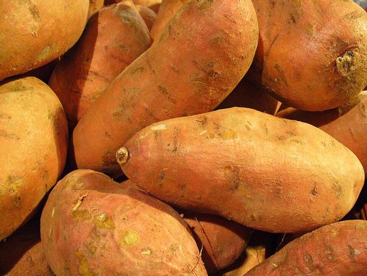

# Sweet potato

*Photo: Llez, [CC BY-SA 3.0](https://creativecommons.org/licenses/by-sa/3.0), via [Wikimedia Commons](https://commons.wikimedia.org/wiki/File:Ipomoea_batatas_006.JPG). Resized.*

> **Darwin and Katherine.** Grows well all year in the NT. It is a long crop, so plant it where it can stay for about five months. Figures come from the NT Government sowing sheet[113](../references.md#r113), which is government but old (2005/2008). Other sources are named below.

## Key facts

| Fact | Value |
|---|---|
| When | All year |
| How | Rhizome or division |
| Depth | 40 to 60 mm |
| Plants apart | 30 cm |
| Rows apart | 100 cm |
| Seedlings up | — |
| First pick | 18 to 20 weeks |

## Soil and rotation

| | |
|---|---|
| Family | Morning glory family |
| Feeder level | Not stated in the sources read. |
| What it takes | Not stated in the sources read. |
| What it gives back | No nitrogen added. Roots and leftover leaves return some organic matter, and compost puts nutrients back [general knowledge]. |
| Plant before it | No source read. |
| Plant after it | A grass green manure in the wet season [inference, from the Top End advice]. Sweet potato hosts root-knot nematodes. |
| Watch out for | Do not follow another root-knot nematode host crop with it [inference]. A WA commercial guide says to return to the same land only every 2 to 4 years to limit scurf. |

The pattern for every crop in this guide is in [what to plant after each crop](../principles.md#what-to-plant-after-each-crop).

## What you need

- Planting material (the sheet gives the method as rhizome or division)
- A raised bed of well-drained sandy loam with plenty of organic matter
- Mulch

## Growing methods

- **In a pot:** No source read for this guide gives a pot size for sweet potato. This is a gap.
- More on pots, soil and water: [small spaces, pots and renting](../start/small-spaces.md).

## How to grow it

1. Make a raised bed of well-drained sandy loam with high organic matter. Avoid heavy clay.
2. Plant 40 to 60 mm deep, plants 30 cm apart, rows 100 cm apart.
3. Mulch after planting to cool the soil, hold moisture and suppress weeds.
4. First picking is about 18 to 20 weeks later.

## Care guide

- **Starting:** Grow from cuttings (slips), not whole roots. Cut shoots 15 to 20 cm long with clean secateurs, leave 5 to 7 cm of the tip above ground and bury the lower half horizontally, 25 to 35 cm apart in rows 90 cm apart[52](../references.md#r52). At home you can sprout a tuber in potting mix or in a jar of water and cut the slips at the base when they are about 15 cm long[327](../references.md#r327).
- **Temperature:** Best growth at 20 to 30 °C. Growth slows below 10 °C and frost damages the plants. It needs a frost-free season of at least 4 to 6 months[52](../references.md#r52).
- **Sun and shade:** Full sun or part shade, with at least six hours of sun a day[327](../references.md#r327).
- **Watering:** Keep the soil moist after planting so cuttings establish. Avoid dry spells from about 50 to 60 days, when the roots start to form. Do not overwater as the crop matures, because that causes rot and cracked skins[52](../references.md#r52). Once established, plants cope with dry spells but grow better with regular water[327](../references.md#r327).
- **Feeding:** Fork in compost before planting, then feed every 6 weeks with a vegetable fertiliser at the label rate (a retailer) [327](../references.md#r327). The WA guide gives farm rates per hectare and warns against over-fertilising, so those are not converted here.
- **Care:** Mulch around the base. Keep vines out of other beds, because they root where they touch. Harvest when the leaves yellow, about 14 to 20 weeks after planting[52](../references.md#r52) or 3 to 5 months[327](../references.md#r327). Cure the roots in a warm, airy place before storing.
- **Common problems and fixes:** Weevil: Yates says there is no treatment, so use the cultural steps in the NT guide below. Scurf: avoid overwatering, plant cuttings only (not infected roots) and return to the same bed only every 2 to 4 years[52](../references.md#r52). Two-spotted mite and whitefly: see the [insect page](../pests/insects.md).
- **Not found:** A Darwin-specific feeding schedule, and sun advice for the NT. The NT sweet potato page could not be read for this section.

## Companion crops

- No source read names companion plants for sweet potato. See the [companion crops page](../companions.md) for what is known, and for flowering strips that suit any crop ([Alyssum, cornflower and buckwheat strips](../companions.md#alyssum-cornflower-and-buckwheat-strips)).

## Pests and diseases

- **Sweet potato weevil:** larvae tunnel through stems and roots, worse in the dry season. Mound soil, fill cracks and plant clean cuttings ([details](../pests/insects.md#sweet-potato-weevil), NT guide[120, p. 40](../references.md#r120)).
- **Tortoise beetle:** usually needs no control except on young plants ([details](../pests/insects.md#sweet-potato-tortoise-beetle), NT guide[120, p. 38](../references.md#r120)).
- **Giant northern termite** can hollow roots, and the damage often shows only at digging ([details](../pests/insects.md#giant-northern-termite), NT guide[120, p. 82](../references.md#r120)).
- **Feathery mottle virus and phytoplasma:** use virus-free cuttings and pull out infected plants ([details](../pests/diseases.md#sweet-potato-feathery-mottle-virus-and-phytoplasma), NT guide[120, p. 186 to 193](../references.md#r120)).
- Sweet potato is a root-knot nematode host, so do not follow another host crop with it `[inference]`.
- The NT page suggests a sorghum or millet green manure before it as general advice `[inference]`.
- Organic fixes are on the [insect pests page](../pests/insects.md) and the [diseases page](../pests/diseases.md).

## See it and watch it

[Photos: search Wikimedia Commons](https://commons.wikimedia.org/w/index.php?search=sweet+potato+Ipomoea+batatas&title=Special%3AMediaSearch&type=image) · [Videos: search YouTube](https://www.youtube.com/results?search_query=how+to+grow+sweet+potato+Australia)

The links open search results for this crop. I have not vetted every result against this guide, so use the photos to identify the plant and check any video advice against the sources above.

## More

[Full Northern Territory guide](../states/nt.md) · [Small spaces and pots](../start/small-spaces.md)

## Sources

Numbers in square brackets on this page are references. Open one for the full source, who published it and what kind of source it is.

[52](../references.md#r52) [113](../references.md#r113) [120](../references.md#r120) [147](../references.md#r147) [327](../references.md#r327)

All references are in the [References appendix](../references.md).
