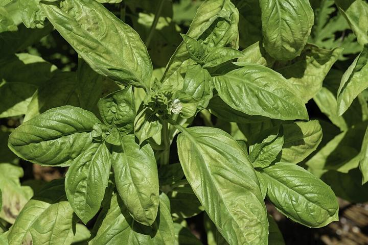

# Basil

*Photo: PumpkinSky, [CC BY-SA 4.0](https://creativecommons.org/licenses/by-sa/4.0), via [Wikimedia Commons](https://commons.wikimedia.org/wiki/File:Ocimum_basilicum_CG_NBG_LR.jpg). Resized.*

> **Sydney.** A sun-loving herb that suits pots. Months and sowing figures come from one council's seed library list[176](../references.md#r176) where listed, with timing and tips from the sources named below. None of them gives frost dates.

## Key facts

| Fact | Value |
|---|---|
| When | September to December (Ryde) |
| Depth | 3 mm (sweet and Thai), 5 mm (lime) |
| Spacing | 30 cm |
| Germination | 3 to 9 days (lime), 5 to 10 days (sweet, Thai) |

## Soil and rotation

| | |
|---|---|
| Family | Mint family [general knowledge] |
| Feeder level | Not stated in the sources read. |
| What it takes | Not stated in the sources read. |
| What it gives back | No nitrogen added. Roots and leftover leaves return some organic matter, and compost puts nutrients back [general knowledge]. |
| Plant before it | No source read. |
| Plant after it | No source read. |

The pattern for every crop in this guide is in [what to plant after each crop](../principles.md#what-to-plant-after-each-crop).

## What you need

- Seed
- A sunny spot, or a pot
- Potting mix

## Growing methods

- **In a pot:** Herbs can grow in pots[99](../references.md#r99). Salisbury says herbs generally prefer shade in summer[186](../references.md#r186). Neither gives a basil-specific pot size.
- More on pots, soil and water: [small spaces, pots and renting](../start/small-spaces.md).

## How to grow it

1. Sow seed 3 to 5 mm deep, 30 cm apart.
2. Seedlings come up in about 3 to 10 days.
3. Herbs like 18 to 21 degrees Celsius to get going, so spring is a good time to plant them outdoors.

## Care guide

- **Starting:** SGA gives planting times only: September in warm and temperate areas, and October in cool to cold areas once frost risk has passed. It gives no seedling method[264](../references.md#r264).
- **Temperature:** Basil dislikes cold and is a summer-growing annual that dies back when it arrives[264](../references.md#r264). The Eastwood seed library says herbs like 18 to 21 °C to get going[176](../references.md#r176).
- **Sun and shade:** Loves full sun. In cooler climates it needs at least four hours of sun a day[264](../references.md#r264).
- **Watering:** Use the finger test, water in the morning, and do not use greywater[264](../references.md#r264).
- **Feeding:** Liquid seaweed, worm wee or liquid manure, fairly often through the season and after harvests. No interval is given[264](../references.md#r264).
- **Care:** Pick often and remove flowers[264](../references.md#r264).
- **Common problems and fixes:** Snails and caterpillars. See the [insect page](../pests/insects.md).
- **Not found:** A seedling method and feeding interval.

## Companion crops

- **Good neighbours:** [Tomato](sydney-cherry-tomato.md).
- **How reliable:** Weak. Most of these pairings are traditional practice, and the trials read found little support for them. Sources: NT sheet VF11[125](../references.md#r125) says basil improves tomatoes and repels flies and mosquitoes. Each pairing is rated on the [companion crops page](../companions.md).
- Flowering strips of alyssum, cornflower or buckwheat are the best-supported companion practice; see [Alyssum, cornflower and buckwheat strips](../companions.md#alyssum-cornflower-and-buckwheat-strips).

## Watch for

- The sources read give no pest advice for basil.
- Organic fixes are on the [insect pests page](../pests/insects.md) and the [diseases page](../pests/diseases.md).

## See it and watch it

[Photos: search Wikimedia Commons](https://commons.wikimedia.org/w/index.php?search=basil+Ocimum+basilicum&title=Special%3AMediaSearch&type=image) · [Videos: search YouTube](https://www.youtube.com/results?search_query=how+to+grow+basil+in+a+pot+Australia)

The links open search results for this crop. I have not vetted every result against this guide, so use the photos to identify the plant and check any video advice against the sources above.

## More

[NSW and ACT guide](../states/nsw-act.md) · [Small spaces and pots](../start/small-spaces.md)

## Sources

Numbers in square brackets on this page are references. Open one for the full source, who published it and what kind of source it is.

[99](../references.md#r99) [125](../references.md#r125) [176](../references.md#r176) [177](../references.md#r177) [186](../references.md#r186) [264](../references.md#r264)

All references are in the [References appendix](../references.md).
