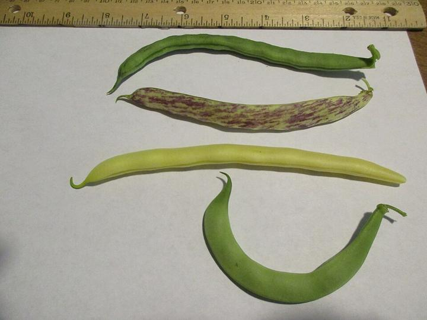

# Bush beans

*Photo: Christopher Franz, [CC BY-SA 4.0](https://creativecommons.org/licenses/by-sa/4.0), via [Wikimedia Commons](https://commons.wikimedia.org/wiki/File:Four_Different_Varieties_of_Green_Beans_(Phaseolus_vulgaris).jpg). Resized.*

> **Sydney.** Compact beans that suit a pot or a bed. Months and sowing figures come from one council's seed library list[176](../references.md#r176) where listed, with timing and tips from the sources named below. None of them gives frost dates.

## Key facts

| Fact | Value |
|---|---|
| When | January to February and September to December (Ryde) |
| Depth | 25 mm |
| Spacing | 15 cm |
| Germination | 8 to 10 days (Gourmet Delight, Cherokee Wax) |

## Soil and rotation

| | |
|---|---|
| Family | Bean family (legume) |
| Feeder level | Soil builder (SGA[267](../references.md#r267)) or light feeder (Salisbury Council[188](../references.md#r188)) |
| What it takes | Little nitrogen, because it makes its own. |
| What it gives back | Fixes nitrogen from the air, which helps about one following crop (GRDC[224](../references.md#r224)). A picked crop returns less, because 30 to 40 percent of the crop's nitrogen leaves in the harvest (SA Soil Quality[165](../references.md#r165)). Leave the roots in the bed [inference]. |
| Plant before it | A green manure. SGA's cycle is legume, heavy feeder, light feeder, green manure (SGA[267](../references.md#r267)). |
| Plant after it | A hungry crop such as tomato, cucumber or lettuce. The nitrogen helps about one crop. Pull the plants and leave the roots in [inference]. |
| Watch out for | A commercial guide gives breaks of 3 to 10 years for some bean soil diseases, which is rarely possible at home. Rotate, use clean seed and drained beds. |

The pattern for every crop in this guide is in [what to plant after each crop](../principles.md#what-to-plant-after-each-crop).

## What you need

- Seed
- A pot 20 to 30 cm deep, or a bed
- A sunny spot

## Growing methods

- **In a pot:** Salisbury puts bush beans in a shallow pot, 15 to 20 cm deep[186](../references.md#r186). The City of Sydney gives 20 to 30 cm for vegetables and herbs[177](../references.md#r177). Both are shown.
- More on pots, soil and water: [small spaces, pots and renting](../start/small-spaces.md).

## How to grow it

1. Sow seed 25 mm deep, 15 cm apart.
2. Seedlings come up in 8 to 10 days.

## Care guide

- **Starting:** Sow seed directly once frost risk has passed, 2.5 cm deep and about 15 cm apart, in rows at least 40 cm apart. Wet the soil before sowing and mulch after germination. A crop takes about 10 to 14 weeks[283](../references.md#r283).
- **Temperature:** A warm-season crop in cool and temperate climates. No figures are given[283](../references.md#r283).
- **Sun and shade:** Full sun[283](../references.md#r283).
- **Watering:** Water regularly in dry weather, daily in hot dry conditions, and less when mild. Keep soil free-draining and avoid overhead watering[283](../references.md#r283).
- **Feeding:** Enrich the soil with compost, rotted manure and blood and bone before planting. If you did, no extra feeding is needed. Seaweed solution at flowering is optional[283](../references.md#r283).
- **Care:** Bush beans reach about 40 cm and need no support. Mulch well, because the roots are shallow, and avoid disturbing the soil[283](../references.md#r283).
- **Common problems and fixes:** Snails and slugs damage seedlings: use pellets or traps. Powdery mildew: avoid overhead watering and leave room for airflow[283](../references.md#r283).
- **Not found:** Temperature figures and pot size.

## Companion crops

- **Good neighbours:** [Corn](../companions.md#corn), [Sunflower](../companions.md#sunflower), [Cucumber](sydney-cucumber.md), [Celery](../companions.md#celery), [Potatoes](../companions.md#potatoes).
- **Keep apart:** [Onions and garlic](../companions.md#onions-and-garlic).
- **How reliable:** Weak. Most of these pairings are traditional practice, and the trials read found little support for them. Sources: NT sheet VF11[125](../references.md#r125) lists corn, sunflowers, cucumber and celery for bush beans. Hornsby fact sheet[182](../references.md#r182) adds onions, garlic and potatoes, which the NT sheet disagrees with for onions. Each pairing is rated on the [companion crops page](../companions.md).
- Flowering strips of alyssum, cornflower or buckwheat are the best-supported companion practice; see [Alyssum, cornflower and buckwheat strips](../companions.md#alyssum-cornflower-and-buckwheat-strips).

## Watch for

- See the [insect pests page](../pests/insects.md) for aphids, and the [diseases page](../pests/diseases.md) for anthracnose of beans and rust.
- Organic fixes are on the [insect pests page](../pests/insects.md) and the [diseases page](../pests/diseases.md).

## See it and watch it

[Photos: search Wikimedia Commons](https://commons.wikimedia.org/w/index.php?search=bush+bean+Phaseolus+vulgaris&title=Special%3AMediaSearch&type=image) · [Videos: search YouTube](https://www.youtube.com/results?search_query=how+to+grow+bush+beans+in+a+pot+Australia)

The links open search results for this crop. I have not vetted every result against this guide, so use the photos to identify the plant and check any video advice against the sources above.

## More

[NSW and ACT guide](../states/nsw-act.md) · [Small spaces and pots](../start/small-spaces.md)

## Sources

Numbers in square brackets on this page are references. Open one for the full source, who published it and what kind of source it is.

[125](../references.md#r125) [165](../references.md#r165) [176](../references.md#r176) [177](../references.md#r177) [182](../references.md#r182) [186](../references.md#r186) [188](../references.md#r188) [224](../references.md#r224) [267](../references.md#r267) [283](../references.md#r283)

All references are in the [References appendix](../references.md).
