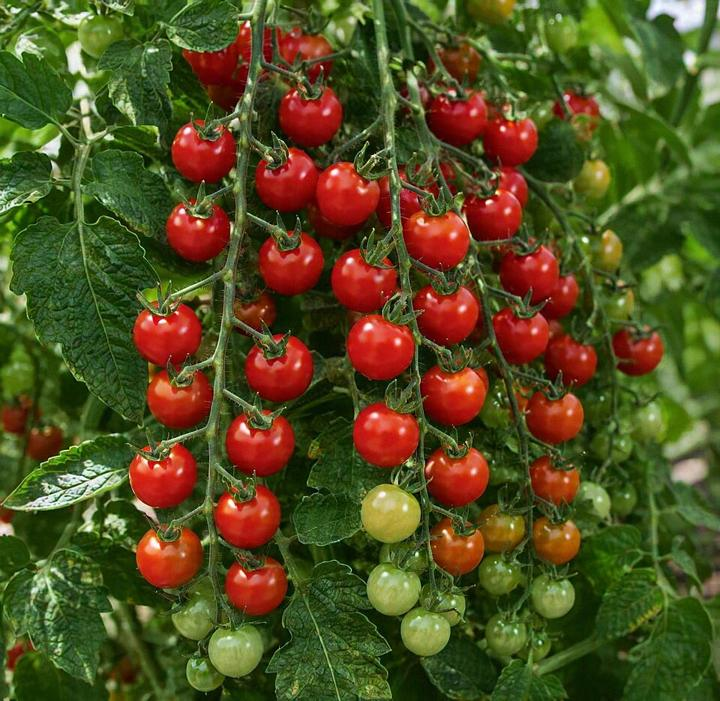

# Cherry tomato

*Photo: Steffen Bauer (saatpilot.de), [CC BY 4.0](https://creativecommons.org/licenses/by/4.0), via [Wikimedia Commons](https://commons.wikimedia.org/wiki/File:Solanum_lycopersicum_%27Small_Red_Cherry%27_(tomato),_fruit,_close-up_(SaatPilot).jpg). Resized.*

> **Sydney.** A popular first fruiting crop. The Ryde guide lists Black Cherry, Red Cherry, Tommy Toe and Scoresby Dwarf types. Months and sowing figures come from one council's seed library list ([City of Ryde seed library guide, June 2024](https://www.ryde.nsw.gov.au/files/assets/public/v/4/library/2024-06-seasonal-planting-guide.pdf)) where listed, with timing and tips from the sources named below. None of them gives frost dates.

## Key facts

| Fact | Value |
|---|---|
| When | August to December (Ryde) |
| Depth | 5 mm |
| Spacing | 50 cm |
| Germination | 5 to 10 days (Black and Red Cherry, Tommy Toe), 10 to 14 days (Scoresby Dwarf) |

## What you need

- Seed
- Small pots to start seedlings
- A sunny spot with 4 to 6 hours of direct sun
- Stakes or a cage `[inference]`

## Growing methods

- **In a pot:** Cherry tomatoes suit a medium pot, 20 to 30 cm deep ([Salisbury Council, growing in pots and containers](https://www.salisbury.sa.gov.au/assets/files/assets/public/general_documents/live/healthy_living/living_well_in_the_living_city/pack_e1_growing_in_pots_and_containers_final.pdf)). Tomatoes can also grow in hanging baskets ([NSW Environment, small spaces](https://www.environment.nsw.gov.au/about-us/get-involved/sydney-nature/gardens/small-spaces)).
- More on pots, soil and water: [small spaces, pots and renting](../start/small-spaces.md).

## How to grow it

1. Sow seed 5 mm deep.
2. Seedlings come up in 5 to 10 days.
3. Plant out 50 cm apart in a sunny spot.

## Companion crops

- **Good neighbours:** [Basil](sydney-basil.md), [Parsley](../companions.md#parsley), [Chives](../companions.md#chives), [Onions and garlic](../companions.md#onions-and-garlic), [Cucumber](sydney-cucumber.md), [Marigold](../companions.md#marigold), [Nasturtium](../companions.md#nasturtium), [Petunias](../companions.md#petunias), [Asparagus](../companions.md#asparagus).
- **Keep apart:** [Potatoes](../companions.md#potatoes), [Eggplant](../companions.md#eggplant), [Corn](../companions.md#corn).
- **Where this comes from:** From [NT sheet VF11](https://daf.nt.gov.au/__data/assets/pdf_file/0005/227606/vf11.pdf) and the [Hornsby fact sheet](https://hornsby.nsw.gov.au/__data/assets/pdf_file/0015/52512/HSC00272-EGFS-Guild-and-Companion-Planting_FA.pdf). The two sources disagree on corn: the NT sheet says avoid it and Hornsby lists it as a companion.
- **How reliable:** weak. Most of these pairings are traditional practice, and the trials read found little support for them. The [companion crops page](../companions.md) rates each one. A name that has a crop page in this guide opens that page. Any other name opens its note on the companion crops page.
- Flowering strips of alyssum, cornflower or buckwheat are the best-supported companion practice; see [Alyssum, cornflower and buckwheat strips](../companions.md#alyssum-cornflower-and-buckwheat-strips).

## Care guide

- **Starting:** The Adelaide council advises seed-raising mix, soil at 25 °C, transplanting at 3 to 5 cm with a second pair of leaves, and hardening off over several days. Plant 7.5 to 10 cm deep with only the top two leaves above ground ([Salisbury](https://www.salisbury.sa.gov.au/assets/files/assets/public/general_documents/live/healthy_living/living_well_in_the_living_city/pack_d7_growing_tomatoes_final.pdf)).
- **Temperature:** Plant out when the soil is 15 to 20 °C and night temperatures are around 15 °C, which in Adelaide is late October to mid November. Use shade cloth in extreme heat ([Salisbury](https://www.salisbury.sa.gov.au/assets/files/assets/public/general_documents/live/healthy_living/living_well_in_the_living_city/pack_d7_growing_tomatoes_final.pdf)). Adelaide is not Sydney, so check local dates.
- **Sun and shade:** At least 6 hours of sun, preferably morning, with shelter from the late afternoon sun ([Salisbury](https://www.salisbury.sa.gov.au/assets/files/assets/public/general_documents/live/healthy_living/living_well_in_the_living_city/pack_d7_growing_tomatoes_final.pdf)).
- **Watering:** A slow, deep soak once a week when rain is irregular, every 2 to 3 days in extreme heat. Check with a finger and water the soil rather than the leaves. In pots, water until it drains and do not use saucers ([Salisbury](https://www.salisbury.sa.gov.au/assets/files/assets/public/general_documents/live/healthy_living/living_well_in_the_living_city/pack_d7_growing_tomatoes_final.pdf)).
- **Feeding:** Feed at least 2 to 3 times over the plant life, with a liquid feed about every 3 weeks. Use a potash-heavy fertiliser, not a high-nitrogen one. Pots need feeding more often ([Salisbury](https://www.salisbury.sa.gov.au/assets/files/assets/public/general_documents/live/healthy_living/living_well_in_the_living_city/pack_d7_growing_tomatoes_final.pdf)).
- **Care:** Tall types need stakes and 80 to 100 cm spacing, and bush types 50 to 60 cm. Use soft ties and pinch the side shoots on tall types ([Salisbury](https://www.salisbury.sa.gov.au/assets/files/assets/public/general_documents/live/healthy_living/living_well_in_the_living_city/pack_d7_growing_tomatoes_final.pdf)).
- **Rotation:** Tomato family, heavy feeder. Salisbury Council says a three-year break before the family returns, and tomato and potato share blight. Follow with a legume or light feeder. See [rotation for the crops in this guide](../principles.md#rotation-for-the-crops-in-this-guide).
- **Plant next, so the soil recovers:** Peas, broad beans or another winter legume. Not potato, eggplant or chilli. See [what to plant after each crop](../principles.md#what-to-plant-after-each-crop).
- **Common problems and fixes:** Blossom end rot: water evenly. Fruit splitting: pick early if heavy rain is forecast. Sunburn: shade cloth. Fungal disease: rotate, prune for airflow and water the base only. Bacterial wilt has no cure ([Salisbury](https://www.salisbury.sa.gov.au/assets/files/assets/public/general_documents/live/healthy_living/living_well_in_the_living_city/pack_d7_growing_tomatoes_final.pdf)).
- **Not found:** A Sydney source for dates and feeding.

## Watch for

- See the [insect pests page](../pests/insects.md) for fruit fly and caterpillars, and the [diseases page](../pests/diseases.md) for wilts and blight.
- Organic fixes are on the [insect pests page](../pests/insects.md) and the [diseases page](../pests/diseases.md).

## See it and watch it

[Photos: search Wikimedia Commons](https://commons.wikimedia.org/w/index.php?search=cherry+tomato+Solanum+lycopersicum&title=Special%3AMediaSearch&type=image) · [Videos: search YouTube](https://www.youtube.com/results?search_query=how+to+grow+cherry+tomatoes+in+pots+Australia)

The links open search results for this crop. I have not vetted every result against this guide, so use the photos to identify the plant and check any video advice against the sources above.

## More

[NSW and ACT guide](../states/nsw-act.md) · [Small spaces and pots](../start/small-spaces.md)

## Sources

- [City of Ryde seed library guide, June 2024](https://www.ryde.nsw.gov.au/files/assets/public/v/4/library/2024-06-seasonal-planting-guide.pdf)
- [Salisbury Council, growing tomatoes (Adelaide)](https://www.salisbury.sa.gov.au/assets/files/assets/public/general_documents/live/healthy_living/living_well_in_the_living_city/pack_d7_growing_tomatoes_final.pdf), council
