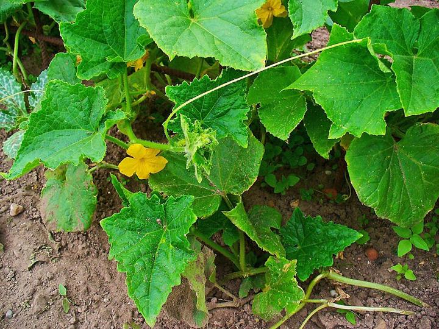

# Cucumber

*Photo: H. Zell, [CC BY-SA 3.0](https://creativecommons.org/licenses/by-sa/3.0), via [Wikimedia Commons](https://commons.wikimedia.org/wiki/File:Cucumis_sativus_0001.JPG). Resized.*

> **Sydney.** Easy, but it needs something to climb. Months and sowing figures come from one council's seed library list[176](../references.md#r176) where listed, with timing and tips from the sources named below. None of them gives frost dates.

## Key facts

| Fact | Value |
|---|---|
| When | January to February and September to December (Ryde). Spring to mid-summer, above 18 degrees (Royal Botanic Gardens) |
| Depth | 10 mm |
| Spacing | 40 cm |
| Germination | 4 to 10 days (Marketmore), 6 to 10 days (Richmond River Green Apple) |

## Soil and rotation

| | |
|---|---|
| Family | Cucumber family (cucurbit) |
| Feeder level | Heavy (SGA[267](../references.md#r267), Salisbury Council[188](../references.md#r188)) |
| What it takes | A lot. Heavy feeders draw hard on the bed (SGA[267](../references.md#r267)). |
| What it gives back | No nitrogen added. Roots and leftover leaves return some organic matter, and compost puts nutrients back [general knowledge]. |
| Plant before it | A legume or a green manure. SGA's cycle puts a legume before a heavy feeder (SGA[267](../references.md#r267)). |
| Plant after it | A winter legume such as faba beans or field peas, or a green manure, then a hungry crop the year after. Do not follow with another cucumber-family crop. |
| Watch out for | Do not follow it with another cucumber-family crop. Root-knot nematodes build under them. |

The pattern for every crop in this guide is in [what to plant after each crop](../principles.md#what-to-plant-after-each-crop).

## What you need

- Seed
- A trellis or strings
- A sunny spot

## Growing methods

- **In a pot:** Cucumber suits a deep pot, 30 to 50 cm or more[186](../references.md#r186). Use a trellis or reinforced mesh for climbers[99](../references.md#r99).
- More on pots, soil and water: [small spaces, pots and renting](../start/small-spaces.md).

## How to grow it

1. Sow seed 10 mm deep, 40 cm apart.
2. Seedlings come up in 4 to 10 days.
3. Train the plants up a trellis or strings.
4. Plant in spring to mid-summer. Cucumbers love summer heat and resent cool, wet weather.

## Care guide

- **Starting:** SGA gives planting windows for temperate areas (September to January) but no method. Sow direct 10 mm deep, 40 to 60 cm apart. Seeds come up in 4 to 10 days in soil at 18 to 35 °C[323](../references.md#r323).
- **Temperature:** A warm-season crop that frost damages[323](../references.md#r323).
- **Sun and shade:** Full sun in cool areas. In hot areas SGA suggests 30 to 50 percent shade[268](../references.md#r268).
- **Watering:** Drip irrigation under a 5 to 7 cm mulch. Do not let the plants dry out or fruit turns bitter. Hand water early in the morning at the roots[268](../references.md#r268).
- **Feeding:** Plenty of compost, then watered-down worm wee or seaweed liquid at planting and when the first small fruits appear. Strong fertilisers give leaves rather than fruit[268](../references.md#r268).
- **Care:** Support the vines, mulch with straw, pinch the tip after 5 to 7 leaves, and cut fruit leaving some stem[268](../references.md#r268).
- **Common problems and fixes:** Fungal disease: clean straw mulch, drip watering and airflow. Poor fruit set: hand-pollinate with a brush. Bitter fruit: water evenly[268](../references.md#r268). Spider mites: eco-oil or wettable sulphur per the label[323](../references.md#r323).
- **Not found:** Feeding intervals.

## Companion crops

- **Good neighbours:** [Beans](sydney-bush-beans.md), [Peas](sydney-peas.md), [Corn](../companions.md#corn), [Sunflower](../companions.md#sunflower), [Radish](sydney-radish.md).
- **Keep apart:** [Aromatic herbs](../companions.md#aromatic-herbs), [Potatoes](../companions.md#potatoes).
- **How reliable:** Weak. Most of these pairings are traditional practice, and the trials read found little support for them. Sources: NT sheet VF11[125](../references.md#r125) and the Hornsby fact sheet[182](../references.md#r182). Each pairing is rated on the [companion crops page](../companions.md).
- Flowering strips of alyssum, cornflower or buckwheat are the best-supported companion practice; see [Alyssum, cornflower and buckwheat strips](../companions.md#alyssum-cornflower-and-buckwheat-strips).

## Watch for

- The [diseases page](../pests/diseases.md) covers powdery and downy mildew, which affect cucurbits.
- Organic fixes are on the [insect pests page](../pests/insects.md) and the [diseases page](../pests/diseases.md).

## See it and watch it

[Photos: search Wikimedia Commons](https://commons.wikimedia.org/w/index.php?search=cucumber+Cucumis+sativus&title=Special%3AMediaSearch&type=image) · [Videos: search YouTube](https://www.youtube.com/results?search_query=how+to+grow+cucumbers+on+a+trellis+Australia)

The links open search results for this crop. I have not vetted every result against this guide, so use the photos to identify the plant and check any video advice against the sources above.

## More

[NSW and ACT guide](../states/nsw-act.md) · [Small spaces and pots](../start/small-spaces.md)

## Sources

Numbers in square brackets on this page are references. Open one for the full source, who published it and what kind of source it is.

[99](../references.md#r99) [125](../references.md#r125) [176](../references.md#r176) [182](../references.md#r182) [186](../references.md#r186) [188](../references.md#r188) [267](../references.md#r267) [268](../references.md#r268) [323](../references.md#r323) [386](../references.md#r386)

All references are in the [References appendix](../references.md).
