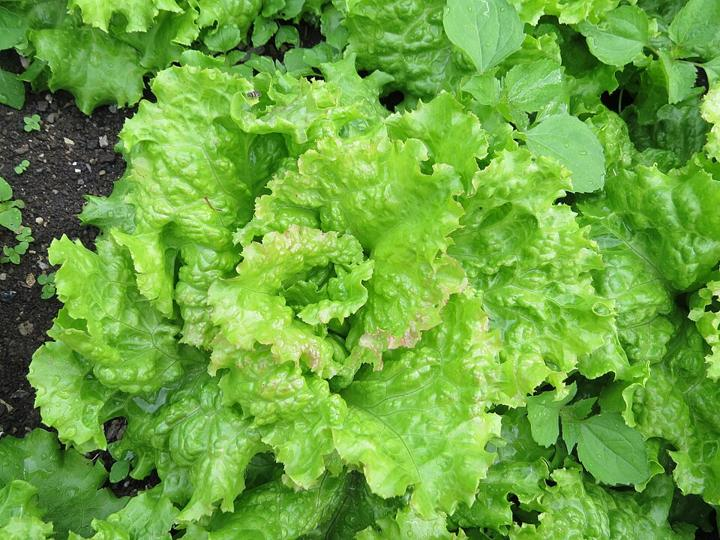

# Lettuce

*Photo: GT1976, [CC BY-SA 4.0](https://creativecommons.org/licenses/by-sa/4.0), via [Wikimedia Commons](https://commons.wikimedia.org/wiki/File:2018-06-18_(109)_Lactuca_sativa_(garden_lettuce)_at_Bichlh%C3%A4usl_in_Frankenfels,_Austria.jpg). Resized.*

> **Sydney.** Traditionally a cool-season crop, but it grows all year. Months and sowing figures come from one council's seed library list ([City of Ryde seed library guide, June 2024](https://www.ryde.nsw.gov.au/files/assets/public/v/4/library/2024-06-seasonal-planting-guide.pdf)) where listed, with timing and tips from the sources named below. None of them gives frost dates.

## Key facts

| Fact | Value |
|---|---|
| When | Goldrush all year; red and green salad March to May and September to December; mignonette January to April and August to December (Ryde) |
| Depth | 3 mm in clumps (5 mm in rows for mignonette) |
| Spacing | 20 cm (35 cm for mignonette) |
| Germination | 8 to 14 days |

## What you need

- Seed
- A pot or bed
- A partly shaded spot for midsummer

## Growing methods

- **In a pot:** Open lettuce suits a shallow pot, 15 to 20 cm deep ([Salisbury Council, growing in pots and containers](https://www.salisbury.sa.gov.au/assets/files/assets/public/general_documents/live/healthy_living/living_well_in_the_living_city/pack_e1_growing_in_pots_and_containers_final.pdf)). Lettuce can grow in pots ([NSW Environment, small spaces](https://www.environment.nsw.gov.au/about-us/get-involved/sydney-nature/gardens/small-spaces)).
- More on pots, soil and water: [small spaces, pots and renting](../start/small-spaces.md).

## How to grow it

1. Sow seed 3 mm deep in clumps, 20 cm apart.
2. Seedlings come up in 8 to 14 days.
3. In midsummer, plant in a partly shaded spot.
4. Pick outer leaves as it grows.

## Companion crops

- **Good neighbours:** [Carrot](../companions.md#carrot), [Cucumber](sydney-cucumber.md), [Radish](sydney-radish.md), [Corn](../companions.md#corn), [Beans](sydney-bush-beans.md), [Celery](../companions.md#celery), [Beetroot](../companions.md#beetroot), [Chives](../companions.md#chives), [Strawberries](sydney-strawberries.md), [Flowers for beneficial insects](../companions.md#flowers-for-beneficial-insects).
- **Keep apart:** [Cabbage family](../companions.md#cabbage-family), [Parsley](../companions.md#parsley).
- **Where this comes from:** From [NT sheet VF11](https://daf.nt.gov.au/__data/assets/pdf_file/0005/227606/vf11.pdf), the [Hornsby fact sheet](https://hornsby.nsw.gov.au/__data/assets/pdf_file/0015/52512/HSC00272-EGFS-Guild-and-Companion-Planting_FA.pdf) and [Diggers](https://www.diggers.com.au/blogs/learn/how-to-grow-lettuce).
- **How reliable:** weak. Most of these pairings are traditional practice, and the trials read found little support for them. The [companion crops page](../companions.md) rates each one. A name that has a crop page in this guide opens that page. Any other name opens its note on the companion crops page.
- Flowering strips of alyssum, cornflower or buckwheat are the best-supported companion practice; see [Alyssum, cornflower and buckwheat strips](../companions.md#alyssum-cornflower-and-buckwheat-strips).

## Care guide

- **Starting:** Sow direct or transplant. Space plants 20 to 30 cm apart, with miniature types 10 to 15 cm. Seeds come up in 2 to 14 days, and harvest takes 50 to 80 days. Transplant in the cool morning or on mild overcast days ([Diggers](https://www.diggers.com.au/blogs/learn/how-to-grow-lettuce)).
- **Temperature:** Seed germinates at 4 to 26 °C and will not germinate above 30 °C. Cos types cope with extremes better. In temperate areas without severe frosts lettuce grows year-round ([Diggers](https://www.diggers.com.au/blogs/learn/how-to-grow-lettuce)).
- **Sun and shade:** Full sun in winter and spring, and some shade in hot, dry summers ([Diggers](https://www.diggers.com.au/blogs/learn/how-to-grow-lettuce)).
- **Watering:** Keep moisture steady, because drops in moisture check growth and increase bitterness. Drip is preferred over overhead watering, which encourages rots and downy mildew. Mulch to hold moisture ([Diggers](https://www.diggers.com.au/blogs/learn/how-to-grow-lettuce)).
- **Feeding:** Use nitrogen-rich manure and add potash, keeping fertiliser near the surface because the roots are shallow. In containers, feed regularly with liquid fertiliser ([Diggers](https://www.diggers.com.au/blogs/learn/how-to-grow-lettuce)).
- **Care:** Weed carefully, since roots are shallow. In pots choose loose-leaf types, use a premium potting mix and water morning and night ([Diggers](https://www.diggers.com.au/blogs/learn/how-to-grow-lettuce)).
- **Common problems and fixes:** Bolting and bitterness: choose varieties for the season, water evenly, shade, and harvest before the centre turns conical. Snails and slugs: baits or beer traps. Damping-off: well-drained beds and no overwatering. Aphids: organic insecticides, and destroy plants with necrotic yellows ([Diggers](https://www.diggers.com.au/blogs/learn/how-to-grow-lettuce)).
- **Not found:** Watering volumes and fertiliser rates.

## Watch for

- Downy mildew affects lettuce. See the [diseases page](../pests/diseases.md).
- Organic fixes are on the [insect pests page](../pests/insects.md) and the [diseases page](../pests/diseases.md).

## See it and watch it

[Photos: search Wikimedia Commons](https://commons.wikimedia.org/w/index.php?search=lettuce+Lactuca+sativa&title=Special%3AMediaSearch&type=image) · [Videos: search YouTube](https://www.youtube.com/results?search_query=how+to+grow+lettuce+in+a+pot+Australia)

The links open search results for this crop. I have not vetted every result against this guide, so use the photos to identify the plant and check any video advice against the sources above.

## More

[NSW and ACT guide](../states/nsw-act.md) · [Small spaces and pots](../start/small-spaces.md)

## Sources

- [Royal Botanic Gardens Sydney, best vegetables for beginners](https://botanicgardens.org.au/discover-and-learn/gardening-home/gardening-tips/best-vegetables-grow-beginners)
- [City of Ryde seed library guide, June 2024](https://www.ryde.nsw.gov.au/files/assets/public/v/4/library/2024-06-seasonal-planting-guide.pdf)
- [Diggers, how to grow lettuce](https://www.diggers.com.au/blogs/learn/how-to-grow-lettuce), retailer
