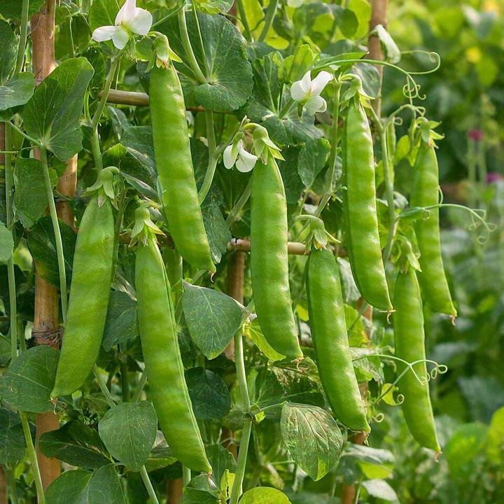

# Peas and snow peas

*Photo: Steffen Bauer (saatpilot.de), [CC BY 4.0](https://creativecommons.org/licenses/by/4.0), via [Wikimedia Commons](https://commons.wikimedia.org/wiki/File:Pisum_sativum_Tall_Telephone_Alderman_(garden_pea),_harvested_pods,_view_2_(SaatPilot).jpg). Resized.*

> **Sydney.** Described as a great first plant for novices. Peas like cool weather and dislike heat. Months and sowing figures come from one council's seed library list ([City of Ryde seed library guide, June 2024](https://www.ryde.nsw.gov.au/files/assets/public/v/4/library/2024-06-seasonal-planting-guide.pdf)) where listed, with timing and tips from the sources named below. None of them gives frost dates.

## Key facts

| Fact | Value |
|---|---|
| When | April to September (Royal Botanic Gardens) |
| Temperature | Above 13 and below 21 degrees |
| Ryde guide | Snow pea is listed with no months ticked |

## What you need

- Seed
- A trellis or support for climbing types `[inference]`

## Growing methods

- **In a pot:** Peas suit a medium pot, 20 to 30 cm deep. Trellised peas need a deep pot, 30 to 50 cm or more ([Salisbury Council, growing in pots and containers](https://www.salisbury.sa.gov.au/assets/files/assets/public/general_documents/live/healthy_living/living_well_in_the_living_city/pack_e1_growing_in_pots_and_containers_final.pdf)). Peas can also grow in hanging baskets ([NSW Environment, small spaces](https://www.environment.nsw.gov.au/about-us/get-involved/sydney-nature/gardens/small-spaces)).
- More on pots, soil and water: [small spaces, pots and renting](../start/small-spaces.md).

## How to grow it

1. Sow in autumn, winter or early spring, from April to September.
2. Peas suit temperatures above 13 and below 21 degrees.

## Companion crops

- **Good neighbours:** [Carrot](../companions.md#carrot), [Radish](sydney-radish.md), [Cucumber](sydney-cucumber.md), [Corn](../companions.md#corn), [Beans](sydney-bush-beans.md), [Squash and pumpkin](../companions.md#squash-and-pumpkin), [Potatoes](../companions.md#potatoes).
- **Keep apart:** [Onions and garlic](../companions.md#onions-and-garlic).
- **Where this comes from:** From [NT sheet VF11](https://daf.nt.gov.au/__data/assets/pdf_file/0005/227606/vf11.pdf) and the [Hornsby fact sheet](https://hornsby.nsw.gov.au/__data/assets/pdf_file/0015/52512/HSC00272-EGFS-Guild-and-Companion-Planting_FA.pdf).
- **How reliable:** weak. Most of these pairings are traditional practice, and the trials read found little support for them. The [companion crops page](../companions.md) rates each one. A name that has a crop page in this guide opens that page. Any other name opens its note on the companion crops page.
- Flowering strips of alyssum, cornflower or buckwheat are the best-supported companion practice; see [Alyssum, cornflower and buckwheat strips](../companions.md#alyssum-cornflower-and-buckwheat-strips).

## Care guide

- **Starting:** Sow direct in a furrow 3 to 5 cm deep, seeds 10 to 15 cm apart, covered with about 2 cm of soil. Rows are 80 to 90 cm apart for climbing peas and 40 to 50 cm for dwarf peas. Shoots appear in about 10 days ([SBS](https://www.sbs.com.au/food/article/how-to-grow-peas/08z56mj9v)).
- **Temperature:** The ideal range is 15 to 24 °C, and peas dislike frost ([SBS](https://www.sbs.com.au/food/article/how-to-grow-peas/08z56mj9v)).
- **Sun and shade:** At least 6 hours of sun a day and some shelter from strong wind ([SBS](https://www.sbs.com.au/food/article/how-to-grow-peas/08z56mj9v)).
- **Watering:** Water the seeds well after sowing, then hold off until they come up, because wet soil can rot them. Start again at 5 to 10 cm and keep moisture even. Mulch to hold it ([SBS](https://www.sbs.com.au/food/article/how-to-grow-peas/08z56mj9v)).
- **Feeding:** Peas fix their own nitrogen and need little. Before planting add manure or compost and a fistful of potash per square metre. Add a sprinkle of all-purpose organic fertiliser when pods start forming ([SBS](https://www.sbs.com.au/food/article/how-to-grow-peas/08z56mj9v)).
- **Care:** Most peas climb, so put supports up before sowing. Pinch the tips at 20 to 30 cm to encourage branching. Dwarf types grow 50 to 75 cm and are mostly self-supporting ([SBS](https://www.sbs.com.au/food/article/how-to-grow-peas/08z56mj9v)).
- **Rotation:** Bean family, soil builder, so put a hungry crop after it. A commercial guide gives breaks of 5 to 6 years for fusarium root rot and pea wilt, which is rarely possible at home. Rotate and use clean seed. See [rotation for the crops in this guide](../principles.md#rotation-for-the-crops-in-this-guide).
- **Plant next, so the soil recovers:** A hungry crop such as tomato, cucumber or lettuce. The nitrogen helps about one crop. Pull the plants and leave the roots in [inference]. See [what to plant after each crop](../principles.md#what-to-plant-after-each-crop).
- **Common problems and fixes:** The page names only frost and seed rot from wet soil. No pest or disease fixes were found in the sources read.
- **Not found:** Pest and disease advice, and pot guidance.

## Watch for

- The sources read give no pest advice for peas.
- Organic fixes are on the [insect pests page](../pests/insects.md) and the [diseases page](../pests/diseases.md).

## See it and watch it

[Photos: search Wikimedia Commons](https://commons.wikimedia.org/w/index.php?search=pea+plant+Pisum+sativum&title=Special%3AMediaSearch&type=image) · [Videos: search YouTube](https://www.youtube.com/results?search_query=how+to+grow+peas+Australia)

The links open search results for this crop. I have not vetted every result against this guide, so use the photos to identify the plant and check any video advice against the sources above.

## More

[NSW and ACT guide](../states/nsw-act.md) · [Small spaces and pots](../start/small-spaces.md)

## Sources

- [Royal Botanic Gardens Sydney, best vegetables for beginners](https://botanicgardens.org.au/discover-and-learn/gardening-home/gardening-tips/best-vegetables-grow-beginners)
- [City of Ryde seed library guide, June 2024](https://www.ryde.nsw.gov.au/files/assets/public/v/4/library/2024-06-seasonal-planting-guide.pdf)
- [SBS, how to grow peas](https://www.sbs.com.au/food/article/how-to-grow-peas/08z56mj9v), media
