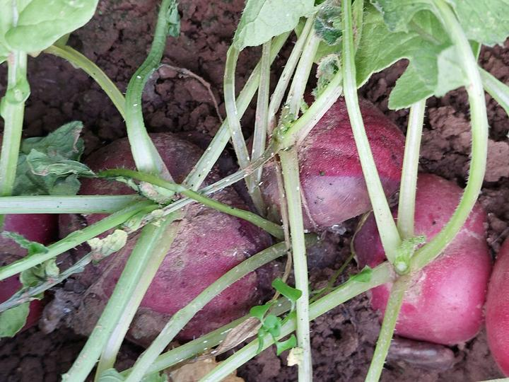

# Radish

*Photo: Schlaghecken Josef, [CC BY-SA 4.0](https://creativecommons.org/licenses/by-sa/4.0), via [Wikimedia Commons](https://commons.wikimedia.org/wiki/File:Raphanus_sativus_Radieschen,_Bakterielle_Nassf%C3%A4ule,_J.Schlaghecken-1a.jpg). Resized.*

> **Sydney.** Radish and turnip are described as the fastest vegetables to grow. Months and sowing figures come from one council's seed library list[176](../references.md#r176) where listed, with timing and tips from the sources named below. None of them gives frost dates.

## Key facts

| Fact | Value |
|---|---|
| When | All year (Ryde). Any time (Royal Botanic Gardens) |
| Depth | 10 mm |
| Spacing | 5 cm |
| Germination | 3 to 14 days |

## Soil and rotation

| | |
|---|---|
| Family | Cabbage family (brassica) |
| Feeder level | Not stated in the sources read. |
| What it takes | Not stated in the sources read. |
| What it gives back | No nitrogen added. Roots and leftover leaves return some organic matter, and compost puts nutrients back [general knowledge]. |
| Plant before it | No source read. |
| Plant after it | A legume, or a green manure that is not a mustard (clubroot risk). |
| Watch out for | Clubroot spores last up to 20 years, so keep cabbage-family crops out of infected beds. A home rotation cannot clear it. |

The pattern for every crop in this guide is in [what to plant after each crop](../principles.md#what-to-plant-after-each-crop).

## What you need

- Seed
- Loose soil, a pot or bed

## Growing methods

- **In a pot:** No source read for this guide names radish for pots. This is a gap.
- More on pots, soil and water: [small spaces, pots and renting](../start/small-spaces.md).

## How to grow it

1. Sow seed 10 mm deep, 5 cm apart.
2. Seedlings come up in 3 to 14 days.

## Care guide

- **Starting:** Sow in loose, well-drained soil with blood and bone dug in. Cover lightly. Seedlings come up in about a week. Thin to 10 to 15 cm and sow every 3 to 4 weeks. Winter types take 8 to 10 weeks and are sown from late summer to early autumn[285](../references.md#r285).
- **Temperature:** No figures. Pull winter types if frost is expected[285](../references.md#r285).
- **Sun and shade:** Full sun[285](../references.md#r285).
- **Watering:** Keep the soil evenly moist. Dry soil causes splitting or bolting[285](../references.md#r285).
- **Feeding:** Not required. Blood and bone at planting, and optionally a liquid organic fertiliser weekly or fortnightly[285](../references.md#r285).
- **Care:** Mulch with sugarcane or pea straw and do not strip too much foliage[285](../references.md#r285).
- **Common problems and fixes:** Splitting and bolting: even moisture. Snails and slugs: baits or barriers. Caterpillars: Bt (DiPel) per the label. Woody roots: harvest on time[285](../references.md#r285).
- **Not found:** Any figure for temperature or watering. Only one retailer page was read.

## Companion crops

- **Good neighbours:** [Peas](sydney-peas.md), [Lettuce](sydney-lettuce.md), [Cucumber](sydney-cucumber.md), [Nasturtium](../companions.md#nasturtium).
- **How reliable:** Weak. Most of these pairings are traditional practice, and the trials read found little support for them. Sources: NT sheet VF11[125](../references.md#r125). Each pairing is rated on the [companion crops page](../companions.md).
- Flowering strips of alyssum, cornflower or buckwheat are the best-supported companion practice; see [Alyssum, cornflower and buckwheat strips](../companions.md#alyssum-cornflower-and-buckwheat-strips).

## Watch for

- The sources read give no pest advice for radish.
- Organic fixes are on the [insect pests page](../pests/insects.md) and the [diseases page](../pests/diseases.md).

## See it and watch it

[Photos: search Wikimedia Commons](https://commons.wikimedia.org/w/index.php?search=radish+Raphanus+sativus&title=Special%3AMediaSearch&type=image) · [Videos: search YouTube](https://www.youtube.com/results?search_query=how+to+grow+radish+in+a+pot+Australia)

The links open search results for this crop. I have not vetted every result against this guide, so use the photos to identify the plant and check any video advice against the sources above.

## More

[NSW and ACT guide](../states/nsw-act.md) · [Small spaces and pots](../start/small-spaces.md)

## Sources

Numbers in square brackets on this page are references. Open one for the full source, who published it and what kind of source it is.

[125](../references.md#r125) [176](../references.md#r176) [285](../references.md#r285) [386](../references.md#r386)

All references are in the [References appendix](../references.md).
