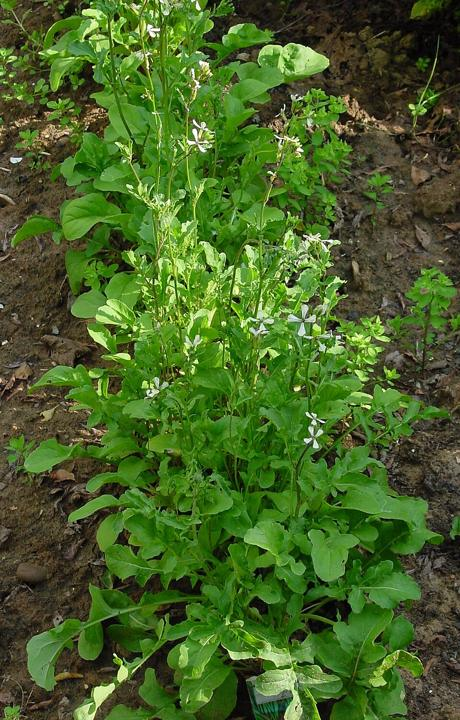

# Rocket

*Photo: Leo Michels, Public domain, via [Wikimedia Commons](https://commons.wikimedia.org/wiki/File:Eruca_sativa_1_IP0206101.jpg). Resized.*

> **Sydney.** One of the fastest salad crops to grow. Months and sowing figures come from one council's seed library list ([City of Ryde seed library guide, June 2024](https://www.ryde.nsw.gov.au/files/assets/public/v/4/library/2024-06-seasonal-planting-guide.pdf)) where listed, with timing and tips from the sources named below. None of them gives frost dates.

## Key facts

| Fact | Value |
|---|---|
| When | All year (Ryde) |
| Depth | 5 mm |
| Germination | 8 to 14 days |
| Ready | About 4 weeks from seed, then cut for months (City of Sydney) |

## What you need

- Seed
- A pot or bed with 20 to 30 cm of soil
- Potting mix

## Growing methods

- **In a pot:** Salisbury puts leafy greens in a shallow pot, 15 to 20 cm deep ([Salisbury Council, growing in pots and containers](https://www.salisbury.sa.gov.au/assets/files/assets/public/general_documents/live/healthy_living/living_well_in_the_living_city/pack_e1_growing_in_pots_and_containers_final.pdf)). The City of Sydney gives 20 to 30 cm for vegetables and herbs ([City of Sydney, tips to start an edible garden](https://news.cityofsydney.nsw.gov.au/articles/tips-to-start-an-edible-garden)). Both are shown.
- More on pots, soil and water: [small spaces, pots and renting](../start/small-spaces.md).

## How to grow it

1. Sow seed about 5 mm deep.
2. Seedlings come up in 8 to 14 days.
3. Harvest from about 4 weeks, and keep cutting. It can be harvested continuously for months.

## Watch for

- The [insect pests page](../pests/insects.md) covers aphids and caterpillars, with organic fixes.
- Organic fixes are on the [insect pests page](../pests/insects.md) and the [diseases page](../pests/diseases.md).

## See it and watch it

[Photos: search Wikimedia Commons](https://commons.wikimedia.org/w/index.php?search=rocket+Eruca+arugula+leaves&title=Special%3AMediaSearch&type=image) · [Videos: search YouTube](https://www.youtube.com/results?search_query=how+to+grow+rocket+in+a+pot+Australia)

The links open search results for this crop. I have not vetted every result against this guide, so use the photos to identify the plant and check any video advice against the sources above.

## More

[NSW and ACT guide](../states/nsw-act.md) · [Small spaces and pots](../start/small-spaces.md)

## Sources

- [City of Sydney, tips to start an edible garden](https://news.cityofsydney.nsw.gov.au/articles/tips-to-start-an-edible-garden)
- [City of Ryde seed library guide, June 2024](https://www.ryde.nsw.gov.au/files/assets/public/v/4/library/2024-06-seasonal-planting-guide.pdf)
