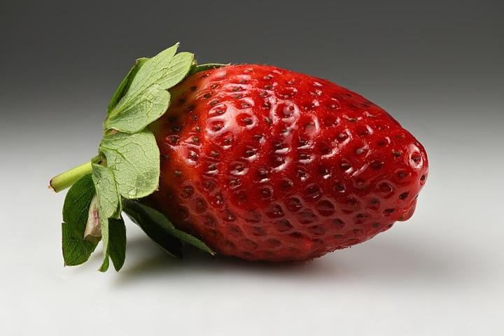

# Strawberries

*Photo: Ivar Leidus, [CC BY-SA 4.0](https://creativecommons.org/licenses/by-sa/4.0), via [Wikimedia Commons](https://commons.wikimedia.org/wiki/File:Garden_strawberry_(Fragaria_%C3%97_ananassa)_single2.jpg). Resized.*

> **Sydney.** Attractive plants that make good hanging baskets or balcony plants. Months and sowing figures come from one council's seed library list ([City of Ryde seed library guide, June 2024](https://www.ryde.nsw.gov.au/files/assets/public/v/4/library/2024-06-seasonal-planting-guide.pdf)) where listed, with timing and tips from the sources named below. None of them gives frost dates.

## Key facts

| Fact | Value |
|---|---|
| When | Any time of year (Royal Botanic Gardens). Alpine strawberry seed June to August (Ryde) |
| Harvest | Peaks in early spring and autumn, with some fruit through summer |
| Seed | Alpine: 3 mm deep, 15 cm apart, 14 to 56 days to germinate |

## What you need

- Plants (or alpine seed)
- A hanging basket or pot
- Potting mix

## Growing methods

- **In a pot:** Strawberries suit a shallow pot, 15 to 20 cm deep ([Salisbury Council, growing in pots and containers](https://www.salisbury.sa.gov.au/assets/files/assets/public/general_documents/live/healthy_living/living_well_in_the_living_city/pack_e1_growing_in_pots_and_containers_final.pdf)).
- More on pots, soil and water: [small spaces, pots and renting](../start/small-spaces.md).

## How to grow it

1. Choose plants listed as "Everbearing" for a longer harvest.
2. Plant any time of year.
3. Pick in early spring and autumn for the main harvest.

## Companion crops

- **Good neighbours:** [Borage](sydney-strawberries.md), [Lettuce](sydney-lettuce.md).
- **Where this comes from:** [Hornsby fact sheet](https://hornsby.nsw.gov.au/__data/assets/pdf_file/0015/52512/HSC00272-EGFS-Guild-and-Companion-Planting_FA.pdf) lists borage. [Diggers](https://www.diggers.com.au/blogs/learn/how-to-grow-lettuce) lists strawberries as a companion for lettuce.
- **How reliable:** weak. Most of these pairings are traditional practice, and the trials read found little support for them. The [companion crops page](../companions.md) rates each one. A name that has a crop page in this guide opens that page. Any other name opens its note on the companion crops page.
- Flowering strips of alyssum, cornflower or buckwheat are the best-supported companion practice; see [Alyssum, cornflower and buckwheat strips](../companions.md#alyssum-cornflower-and-buckwheat-strips).

## Care guide

- **Starting:** Plant runners with healthy white roots, 20 to 30 cm apart, in a slightly raised bed 15 to 20 cm high or a pot. Keep the crown at ground level, not buried ([SGA](https://www.sgaonline.org.au/strawberries/)).
- **Temperature:** A cool-climate plant. No temperature figures are given ([SGA](https://www.sgaonline.org.au/strawberries/)).
- **Sun and shade:** In cool areas full sun to part shade, ideally morning sun and protection from afternoon sun. In warm areas use shade cloth. Good airflow matters ([SGA](https://www.sgaonline.org.au/strawberries/)).
- **Watering:** Sub-surface drip is best. Keep soil moist but not soaked, and avoid wetting leaves and fruit. Roots are shallow, so water regularly, and slightly less during fruiting improves flavour ([SGA](https://www.sgaonline.org.au/strawberries/)).
- **Feeding:** Weak manure tea at about week three and full-strength seaweed tea at flowering. Everbearing types can have an occasional blood and bone. In pots use half-strength feeds more often ([SGA](https://www.sgaonline.org.au/strawberries/)).
- **Care:** Mulch between plants with straw or pine needles, and avoid overhead watering. Move plants to fresh soil every three years, and not where tomatoes, eggplant, capsicum or chilli grew in the past three years ([SGA](https://www.sgaonline.org.au/strawberries/)).
- **Rotation:** A multi-year crop. SGA says move it to a new bed every three years, and not where tomato-family crops grew in the last three years. See [rotation for the crops in this guide](../principles.md#rotation-for-the-crops-in-this-guide).
- **Plant next, so the soil recovers:** A new bed. SGA says move every three years, and not where tomato-family crops grew in the last three years. Nothing sourced for the old bed. See [what to plant after each crop](../principles.md#what-to-plant-after-each-crop).
- **Common problems and fixes:** Virus (yellow stripes on leaves): pull out and bag the plants. Mould and fungus: straw mulch and no overhead watering. Slugs: see SGA ([SGA](https://www.sgaonline.org.au/strawberries/)).
- **Not found:** Pot size, temperature figures and feeding quantities.

## Watch for

- The sources read give no pest advice for strawberries.
- Organic fixes are on the [insect pests page](../pests/insects.md) and the [diseases page](../pests/diseases.md).

## See it and watch it

[Photos: search Wikimedia Commons](https://commons.wikimedia.org/w/index.php?search=strawberry+plant+Fragaria+ananassa&title=Special%3AMediaSearch&type=image) · [Videos: search YouTube](https://www.youtube.com/results?search_query=how+to+grow+strawberries+in+pots+Australia)

The links open search results for this crop. I have not vetted every result against this guide, so use the photos to identify the plant and check any video advice against the sources above.

## More

[NSW and ACT guide](../states/nsw-act.md) · [Small spaces and pots](../start/small-spaces.md)

## Sources

- [Royal Botanic Gardens Sydney, best vegetables for beginners](https://botanicgardens.org.au/discover-and-learn/gardening-home/gardening-tips/best-vegetables-grow-beginners)
- [City of Ryde seed library guide, June 2024](https://www.ryde.nsw.gov.au/files/assets/public/v/4/library/2024-06-seasonal-planting-guide.pdf)
- [SGA, strawberries](https://www.sgaonline.org.au/strawberries/), community
